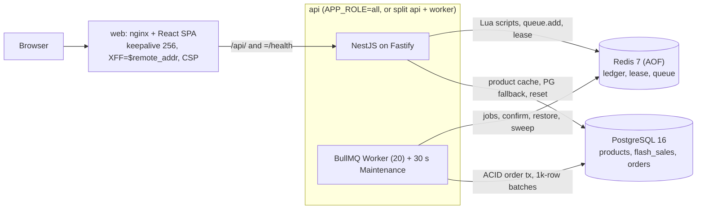
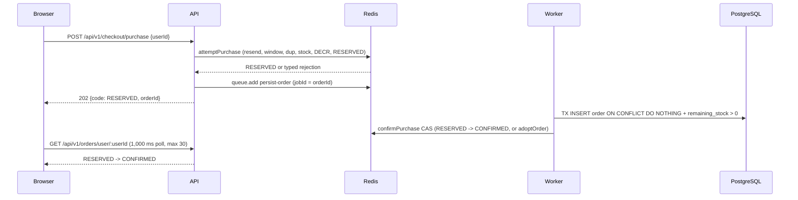

# Flash Sale System

High-throughput flash sale API and React storefront selling one limited product with strict `1`-per-user and total-stock invariants. NestJS on Fastify adjudicates purchases in Redis Lua, BullMQ persists orders asynchronously to PostgreSQL, and nginx proxies the storefront over pooled HTTP/1.1 keep-alive connections.

## Quick Start

Requires Docker with Compose v2.

```sh
cp .env.example .env                  # TRUST_PROXY defaults false for host; Compose defaults true behind nginx
docker compose up -d --build --wait   # postgres, redis, api, web
curl http://localhost:3000/health     # {"status":"ok","checks":{"database":"up","redis":"up"}}
# Open http://localhost:8080 in your browser (Demo scenarios drawer resets stock/windows)
```

Ports `3000`, `8080`, `5432`, and `6379` bind to `127.0.0.1`. First boot creates tables under an advisory lock and seeds one product plus a 24 h, 100-unit active sale (`SALE_*` env vars override when no order or reservation exists).

## How the Brief Is Met

| Requirement | Implementation | Where |
| --- | --- | --- |
| Configurable window | `SALE_STARTS_AT`/`SALE_ENDS_AT` or admin reset; inclusive server-clock bounds | [Purchase flow](docs/purchase-flow.md#stage-2-the-gate) |
| Limited stock, no oversell | Redis `DECR` only at `stock > 0`; PostgreSQL `remaining_stock > 0` + `CHECK` | [Architecture](docs/architecture.md#who-owns-which-data) |
| One item per user | Normalized `userId`, Lua duplicate gate, `UNIQUE (flash_sale_id, user_id)` | [Purchase flow](docs/purchase-flow.md#stage-1-the-user-id) |
| Status, purchase & lookup | `/flash-sales/current`, `/checkout/purchase`, `/orders/user/:userId` | [HTTP API](docs/api.md) |
| React storefront | Boundary-scheduled countdown (`setTimeout`), `[userId, orderId]`-keyed poller (`1s × 30`) | [Architecture](docs/architecture.md#frontend) |
| High throughput & split mode | Hot path does 1 Lua + enqueue (no DB write); `APP_ROLE=api\|worker` split | [Scaling](docs/scaling.md) |
| Fault tolerance | 5-min retries, PG-first compensation, 30 s orphan sweep, chunked Redis restore | [Fault tolerance](docs/fault-tolerance.md) |
| Tests & stress benchmarks | 998 automated tests + Node & k6 stress suites (single-node & scaled) | [Testing](docs/testing.md), [Benchmarks](docs/benchmarks.md) |

**Docs:** [Architecture](docs/architecture.md) · [Purchase Flow](docs/purchase-flow.md) · [Fault Tolerance](docs/fault-tolerance.md) · [Design Decisions](docs/design-decisions.md) · [Scaling](docs/scaling.md) · [HTTP API](docs/api.md) · [Testing](docs/testing.md) · [Benchmarks](docs/benchmarks.md) · [Development](docs/development.md)

## Architecture



- **Strict `APP_ROLE` isolation:** `all` runs everything; `docker-compose.scaled.yml` splits `api` (no BullMQ consumer queue/processor, default DB pool `5` via `DATABASE_POOL_MAX`) from `worker` (mounts `/health` and `/metrics` only, pool `20`, 2-strike boot sweep).
- **Single ledger owner & hash tags:** `modules/sale-ledger` owns all `flash_sale:{saleId}:*` keys and 7 idempotent Lua scripts; `queue.resume()` runs fenced under `maintenance_lock` during boot and ticks.
- **Resilient reads & adoption:** `ProductsService` uses a 60 s singleflight cache with 5 s stale fallback backoff; `FlashSalesService` caches `FOUND` snapshots 200 ms (`Cache-Control: no-store`) and checks PostgreSQL on `NOT_CONFIGURED` to return `503` instead of a false `404`; `OrdersService` answers `NONE` from intact Redis (`no-store`); `adoptOrder` confirms committed orders at `stock <= 0` while clamping displayed `remainingStock >= 0`.
- **Clean security boundary:** Fastify attaches `X-Content-Type-Options`, `X-Frame-Options`, and `Referrer-Policy` on API responses; nginx adds those plus `Content-Security-Policy` only on static `location /` responses without duplicating API headers, and keeps `/metrics` internal on port `3000`.

## Purchase Flow



- **No oversell:** Redis decrements only at `stock > 0`; PostgreSQL enforces `remaining_stock > 0` and `CHECK` bounds.
- **One unit per buyer:** Normalized `userId` (`a-z0-9._@+-`, 3–128 chars) is checked in Lua and PostgreSQL `UNIQUE (flash_sale_id, user_id)`.
- **Every `202` resolves:** BullMQ retries DB faults every 2 s (150 attempts, ~5 min); rejections or exhausted retries trigger PG-first compensation; 30 s maintenance sweeps orphans (2 ticks) and restores lost keys in 1,000-row batches.

## HTTP API & Error Codes

Routes sit under `/api/v1` except `/health` and `/metrics` (`Cache-Control: no-store` on status/lookup; `public, max-age=60, stale-while-revalidate=300` on featured product).

| Endpoint | Purpose & Guards |
| --- | --- |
| `GET /health` | `200` if PG & Redis answer within 1 s, else `503` |
| `GET /metrics` | Internal Prometheus text (`flash_sale_purchase_attempts_total`, `flash_sale_order_persistence_total`, `flash_sale_order_queue_jobs`) |
| `GET /api/v1/products/featured` | Featured product (`60 s` singleflight cache + 5 s stale DB backoff) |
| `GET /api/v1/flash-sales/current` | `saleState` (`UPCOMING` / `ACTIVE` / `SOLD_OUT` / `ENDED`), stock, window, `serverTime` |
| `POST /api/v1/checkout/purchase` | Reserves unit (`202`) or typed refusal; optional `RateLimitGuard` |
| `GET /api/v1/orders/user/:userId` | `NONE`, `RESERVED`, or `CONFIRMED` + `orderId`; optional `RateLimitGuard` |
| `POST /api/v1/admin/flash-sales/reset` | `404` if disabled, `401` on `ADMIN_API_KEY` mismatch, `415` without `Content-Type: application/json`, `RateLimitGuard` protected |

| Status | `code` | Trigger |
| --- | --- | --- |
| `202` | `RESERVED` | Unit reserved and persistence job queued |
| `400` | `INVALID_USER_ID` / `BAD_REQUEST` | Invalid `userId` or reset payload (zoned RFC 3339 timestamps) |
| `401` | `UNAUTHORIZED` | Missing/wrong `x-admin-key` when `ADMIN_API_KEY` is configured |
| `409` | `ALREADY_PURCHASED` | Buyer already holds a reservation or order |
| `410` | `SOLD_OUT` | Remaining stock is `0` |
| `413` / `415` | `PAYLOAD_TOO_LARGE` / `UNSUPPORTED_MEDIA_TYPE` | Body > 16 KiB, or admin reset POST missing `application/json` |
| `422` | `SALE_UPCOMING` / `SALE_ENDED` | Request outside `[startsAt, endsAt]` |
| `429` | `RATE_LIMITED` | Per-IP limit exceeded (`RATE_LIMIT_ENABLED=true`, sets `Retry-After`) |
| `503` | `TEMPORARY_FAILURE` | Redis, PG, queue, or missing stock key failure |

## Testing, Verification & Stress Benchmarks

`pnpm verify` validates 9 gates (`postgres` + `redis` healthy, `pnpm lint` Biome + `arch-check` with 0 exceptions, `pnpm test:scripts`, `pnpm -r typecheck`, both `api` and `worker` compose containers stopped, `jest --detectOpenHandles` with 0 open handles, `web` Vitest, `pnpm -r build`). CI (`.github/workflows/ci.yml`) runs `quality-and-unit` (+ compose config checks) and `api-integration` with the open-handle failure guard.

| Suite | Command | Result |
| --- | --- | --- |
| API unit | `pnpm --filter @flash-sale/api test:unit` | `56` files, `517` passed |
| API integration & E2E | `pnpm --filter @flash-sale/api test:integration` | `32` files (`28` integration + `4` E2E), `199` passed |
| Web (Vitest + RTL) | `pnpm --filter @flash-sale/web test` | `21` files, `214` passed |
| Scripts (`arch-check` + stress) | `pnpm test:scripts` | `5` files (`23` suites), `68` passed |

Stress benchmarks (2026-11-23, 4-vCPU / 2-physical-core WSL2 host, `RATE_LIMIT_ENABLED=false`; full series in [docs/benchmarks.md](docs/benchmarks.md)):

| Run | Mode | Result |
| --- | --- | --- |
| `pnpm stress:node` | Single-node (`localhost:3000`) | `STRESS OK` (53 `PASS`): `oversell` `2,160.0/s`, `same-user-race` `2,010.2/s`, `mixed` `2,167.3/s` (concurrent 3x duplicate races), `pg-blip` (45 s outage, `3×202` confirmed) |
| `pnpm stress:node oversell mixed same-user-race` | Scaled (`--scale api=2` + `worker` via `:8080`) | `STRESS OK`: `oversell` `950.1/s`, `mixed` `991.1/s`, `same-user-race` `1,275.2/s`, all store checks `PASS` |
| `pnpm stress:k6:realistic` | Single-node via `http://web:80` (warmed) | `12/12` thresholds `PASS` (`16k` buyers over `9.01 s` full 8 s overlap + 50/50 buyer/non-buyer lookups): `1,420.1` buy/s (`p95 278.0`, `p99 335.8 ms`), `545.9` read/s (`p99 234.0 ms`), `213.5` lookup/s (`p99 286.6 ms`), `0%` failed |
| `pnpm stress:k6:realistic` | Scaled (`--scale api=2` + `worker` via `web:80`) | `100/0/15900/0`, `0%` failed (`1,050.6` and `822.3` buy/s across 2 runs); saturates 2 physical host cores |

## Key Trade-offs & Production Scaling

- **Single-process default vs split mode:** `APP_ROLE=all` simplifies local runs; `docker-compose.scaled.yml` separates stateless `api` replicas from `worker` via Redis `maintenance_lock`, keeping micro-caches, metrics counters, and `RateLimitGuard` per-process.
- **Redis Cluster & hot-row writes:** `{saleId}` hash tags shard multiple sales today; scaling one massive sale further requires stock sub-buckets and micro-batched worker `remaining_stock` updates ([Scaling](docs/scaling.md)).
- **Window & durability bounds:** `appendfsync everysec` risks ~1 s of unpersisted reservations on sudden Redis loss (PG guards prevent oversell/duplicates), and 5-min job retries bound PostgreSQL outages before compensation releases units.
- **Per-IP rate limiting & demo reset:** `RateLimitGuard` defaults `false` so single-host stress runs are not throttled; production should pair edge/Redis rate limiting and authenticated user IDs, keeping `ENABLE_ADMIN_ENDPOINTS=false` or protected by `ADMIN_API_KEY`.
- **Polling vs push:** 2 s status and 1 s order polling with boundary `setTimeout` avoids open sockets at up to ~2.2 s lag for out-of-band stock exhaustion ([Design decisions](docs/design-decisions.md)).

## Development Without Docker

Requires Node `>=24` (`.nvmrc`) and `pnpm@12.16.1`:

```sh
nvm use && corepack enable
cp .env.example .env
docker compose up -d --wait postgres redis
pnpm install && pnpm --filter @flash-sale/api build
pnpm --filter @flash-sale/api start   # or pnpm --filter @flash-sale/web dev (port 5173)
```
