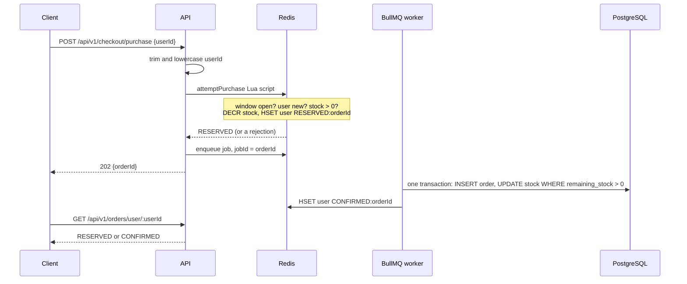

# Flash sale system

A backend for a flash sale that sells one limited product to many buyers at once. Each buyer gets at most one unit, and the sale never sells more units than it has. The API is NestJS on Fastify. Redis decides who gets a unit, PostgreSQL stores the orders, and a BullMQ queue moves each reservation from one to the other.

Status: the API is complete through the purchase path, order lookup, and admin reset (Phases 1 to 3). The React storefront (Phase 4), the k6 stress suite with latency numbers (Phase 5), and the full Docker stack with its final README (Phase 6) are not built yet.

## How a purchase works



One Lua script makes the whole decision inside Redis. It checks the sale window, then whether the user already holds a unit, then the stock. A reservation decrements the stock and records `RESERVED:<orderId>` for the user in the same step. Because Redis runs one script at a time, two buyers can never take the last unit together, and two requests from one user cannot both pass the duplicate check.

The HTTP request ends after the enqueue, so a buyer waits for Redis only, not for PostgreSQL. A worker with concurrency 20 persists the order. It retries 5 times with exponential backoff starting at 300 ms. The worker writes only while the Redis entry still holds its order id, so a job whose reservation was released or wiped by a reset writes nothing. When the last attempt fails, a compensation job with its own retries asks PostgreSQL first. An order that did commit is marked CONFIRMED. Otherwise the reservation is released and the unit returns to the stock.

PostgreSQL is the source of truth. A unique key on `(flash_sale_id, user_id)` and the `remaining_stock > 0` condition stop a duplicate or an extra order even if Redis were wrong. On boot, when the Redis keys for the sale are missing, the API rebuilds them from PostgreSQL. Remaining stock becomes total stock minus confirmed orders.

## HTTP API

All routes except `/health` live under `/api/v1`.

| Method | Path | Result |
| --- | --- | --- |
| `GET` | `/health` | 200 when PostgreSQL and Redis answer, 503 otherwise |
| `GET` | `/api/v1/products/featured` | The product on sale |
| `GET` | `/api/v1/flash-sales/current` | Sale state (`UPCOMING`, `ACTIVE`, `SOLD_OUT`, `ENDED`), stock, window. Cached for 200 ms |
| `POST` | `/api/v1/checkout/purchase` | Body `{ "userId": "..." }`. Outcomes below |
| `GET` | `/api/v1/orders/user/:userId` | `NONE`, `RESERVED` or `CONFIRMED`, with the `orderId` |
| `POST` | `/api/v1/admin/flash-sales/reset` | Demo tool. Body `{ totalStock?, startsOffsetSeconds?, durationSeconds?, productName? }`. Returns 404 when `ENABLE_ADMIN_ENDPOINTS=false` |

| Purchase outcome | Status | `code` |
| --- | --- | --- |
| Unit reserved | 202 | `RESERVED` |
| User already holds a unit | 409 | `ALREADY_PURCHASED` |
| No stock left | 410 | `SOLD_OUT` |
| Sale not started, or over | 422 | `SALE_UPCOMING`, `SALE_ENDED` |
| User id is not 3 to 128 characters of `a-z 0-9 . _ @ + -` after trimming and lowercasing | 400 | `INVALID_USER_ID` |
| Redis or the queue failed | 503 | `TEMPORARY_FAILURE` |

The API trims and lowercases user ids, so `" Alice@Example.com "` and `alice@example.com` are the same buyer.

## Run it locally

You need Node 20 or later, pnpm 12, and Docker.

```sh
cp .env.example .env          # change POSTGRES_PORT or REDIS_PORT if those ports are taken
docker compose up -d postgres redis
pnpm install
pnpm --filter @flash-sale/api build
pnpm --filter @flash-sale/api start
```

The API creates its tables on boot, seeds the sample product and a sale that is open for 24 hours with 100 units, and listens on `PORT` (3000 by default).

## Tests

```sh
pnpm --filter @flash-sale/api test:unit         # no containers needed
pnpm --filter @flash-sale/api test:integration  # needs the postgres and redis containers
pnpm --filter @flash-sale/api test:e2e          # the HTTP end-to-end suites only
pnpm verify                                     # lint, typecheck, build and every test
```

The integration suites run against the real PostgreSQL 16 and Redis 7 containers, read the root `.env`, and run one file at a time because they share one queue. The end-to-end suites boot the whole application and drive it over HTTP. Jest exits cleanly under `--detectOpenHandles` without `--forceExit`. On shutdown the worker and queue close before the Redis connection, and `shutdown-order.redis.spec.ts` fails if that order breaks.

## Concurrency results

These counts check correctness only. Throughput and latency belong to the Phase 5 stress suite.

| Run | Requests | Result |
| --- | --- | --- |
| `flash-sale-race.e2e-spec.ts`, one Node process | 100 buyers, 10 units | 10 × 202, 90 × 410, 10 orders, `remaining_stock` 0 |
| `flash-sale-race.e2e-spec.ts`, one Node process | 50 requests from one user | 1 × 202, 49 × 409 |
| Live API, 80 parallel `curl` processes | 400 buyers, 10 units | 10 × 202, 390 × 410, Redis stock 0, 10 orders, `remaining_stock` 0 |
| Live API, 80 parallel `curl` processes | 200 requests from one user in 4 case and space variants | 1 × 202, 199 × 409, 1 order |

## Design decisions

- **Rejections are values.** `CheckoutService.attemptPurchase` returns a discriminated union for the five business outcomes and throws only for infrastructure faults. Sold out and duplicate are the common case under load, and an exception would capture a stack trace for each one. The controller maps the outcome to a status through an exhaustive table, so a new outcome without a status fails the build.
- **A normalized user id is its own type.** `NormalizedUserId` is a branded string. Only the normalizer and the order repository's row mapper can create one, so a raw id cannot reach a service or repository without a compile error.
- **The Redis wire format stays in one file.** Only the Lua scripts and `order-cache.repository.ts` know about `RESERVED:<orderId>` and `CONFIRMED:<orderId>`. Every other layer sees a typed `{ status, orderId }`.
- **The order id is the job id.** BullMQ refuses custom job ids that contain `:`, so `saleId:userId` cannot work. The order id is unique per reservation, so the same user can buy again after a reset without colliding with an old job.
- **Rollback is scoped to one order.** The rollback script releases a unit only while the entry still equals `RESERVED:<orderId>`. Repeating it, or running it after the order was confirmed or the user reserved again, changes nothing.
- **The module graph has no cycles.** Checkout depends on orders, and admin depends on products, flash sales and orders. Rollback lives in the orders module, so orders never needs checkout.

## Known limits and tradeoffs

- **An unclear enqueue releases the reservation.** When `queue.add` fails, the API looks the job up by its order id. It keeps the reservation only if the job exists. Otherwise it releases the reservation and answers 503, and a job that was stored after all finds its reservation gone and writes nothing. One race is left. If the reply was lost, the lookup failed too, and a worker picked the job up just before the release, that job still writes its order. Redis then offers one unit more than PostgreSQL holds, so the buyer who takes it gets 202 and is released later.
- **Compensation needs Redis to start.** The worker queues the compensation job when the last attempt fails. If Redis is unreachable at that moment, nothing can be queued, the reservation stays held, and the API logs an error. The same holds when the compensation job uses up its 8 retries. An admin reset clears the held unit.
- **Boot hydration is a check and then a write.** It is not atomic across several API instances. It runs once per boot, before the server accepts requests, and the compose stack runs one API instance.
- **Reset is a demo tool.** It pauses the persistence queue, waits up to 10 seconds for jobs in flight (503 if they do not finish), discards the waiting and delayed jobs, rebuilds the sale, and resumes the queue. If the process dies in the middle, the next boot resumes the queue. A purchase that reserves against the old state while the reset runs gets 202, but its job finds the reservation gone, so that buyer ends with no order. The reset has no authentication beyond the `ENABLE_ADMIN_ENDPOINTS` switch. `productName` changes only the cached sale, not the stored product.
- **The system runs one sale.** The active sale id is a constant.

## Repository layout

```text
apps/api/src/
  common/            user id normalizer and pipe, clock, error filter
  config/            environment validation
  infrastructure/    database, redis (with the Lua scripts), queue
  modules/
    products/        featured product
    flash-sales/     sale status and campaign rows
    checkout/        purchase endpoint and the Redis gatekeeper
    orders/          persistence queue, worker, lookup, Redis order ledger
    admin/           boot hydration and reset
apps/api/test/
  unit/              one spec per class, collaborators mocked
  integration/       real PostgreSQL and Redis; *.e2e-spec.ts boot the whole app
apps/web/            React storefront (Phase 4)
```

Engineering rules (test-first development, layering, size limits) are in [AGENTS.md](AGENTS.md).
