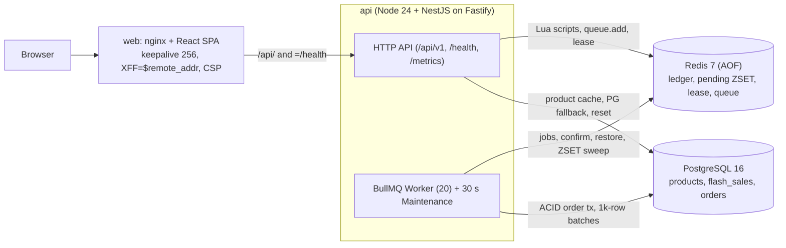
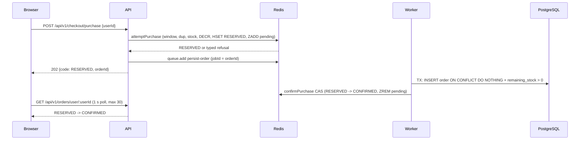

# Flash Sale System

High-throughput flash sale API and React storefront selling one limited-stock product with strict `1`-per-user and no-oversell invariants. NestJS on Fastify adjudicates purchases atomically in Redis Lua, BullMQ persists orders asynchronously to PostgreSQL, and nginx proxies the storefront over pooled HTTP/1.1 keep-alive connections.

## Quick Start

Requires Docker with Compose v2.

```sh
cp .env.example .env                  # TRUST_PROXY defaults false on host; Compose defaults true behind nginx
docker compose up -d --build --wait   # postgres, redis, api, web
curl http://localhost:3000/health     # {"status":"ok","checks":{"database":"up","redis":"up"}}
# Open http://localhost:8080 in your browser (use "Demo scenarios" drawer to test stock/windows)
```

Ports `3000`, `8080`, `5432`, and `6379` bind to `127.0.0.1`. First boot creates tables under a PostgreSQL advisory lock and seeds one product plus a 24 h, 100-unit active sale (`SALE_*` env vars override when no order or reservation exists).

## How the Requirements Are Met

| Requirement | Implementation | Details |
| --- | --- | --- |
| Configurable sale window | `SALE_STARTS_AT`/`SALE_ENDS_AT` or admin reset; inclusive server-clock bounds | [Architecture](docs/architecture.md#5-purchase-flow) |
| Limited stock, no oversell | Redis Lua `DECR` only at `stock > 0`; PostgreSQL `remaining_stock > 0` + `CHECK` | [Architecture](docs/architecture.md#2-data-ownership-and-two-layer-invariants) |
| One item per user | Normalized `userId`, Lua duplicate gate, PostgreSQL `UNIQUE (flash_sale_id, user_id)` | [Architecture](docs/architecture.md#2-data-ownership-and-two-layer-invariants) |
| Status, purchase & lookup API | `/flash-sales/current`, `/checkout/purchase`, `/orders/user/:userId` | [API & Dev](docs/api-and-development.md#1-http-api-reference) |
| React storefront | Boundary-scheduled countdown (`setTimeout`), `[userId, orderId]`-keyed poller (`1 s × 30`) | [Architecture](docs/architecture.md#5-purchase-flow) |
| High throughput & scalability | Single Lua + enqueue hot path (no DB write), auto-pipelined Redis, clear 10x-100x scaling plan | [Architecture](docs/architecture.md#8-scaling-to-production-10x-100x) |
| Fault tolerance | 5-min retries, PG-first compensation, stateless `O(pending)` Redis `ZSET` sweep, chunked Redis restore | [Architecture](docs/architecture.md#6-fault-tolerance-and-recovery) |
| Tests & stress benchmarks | 914 automated tests + Node & k6 stress suites (including 45 s PG outage & 330-VU nginx mix) | [API & Dev](docs/api-and-development.md#3-testing-static-checks-and-verification), [Benchmarks](docs/benchmarks.md) |

**Documentation:** [Architecture, Fault Tolerance & Scaling](docs/architecture.md) · [HTTP API, Development & Testing](docs/api-and-development.md) · [Benchmarks & Stress Results](docs/benchmarks.md)

## Architecture



- **Redis decides, PostgreSQL records:** `modules/sale-ledger` is the sole owner of all `flash_sale:{saleId}:*` keys (using `{saleId}` cluster hash tags) and 7 idempotent Lua scripts. Expected refusals (`409`, `410`, `422`) return typed discriminated unions without throwing V8 exceptions.
- **Stateless `O(pending)` self-healing:** `attemptPurchase` indexes active reservations in a Redis `ZSET` (`flash_sale:{saleId}:pending`), `confirmPurchase` and `rollbackPurchase` remove them atomically, and the 30 s maintenance loop acquires `maintenance_lock` to sweep expired jobless orphans (`ZRANGEBYSCORE`, 30 s grace window) and restore missing keys from PostgreSQL in 1,000-row keyset batches.
- **Resilient reads & adoption:** `ProductsService` uses a 60 s singleflight cache with 5 s stale fallback backoff; `FlashSalesService` caches `FOUND` snapshots 200 ms (`Cache-Control: no-store`) and checks PostgreSQL on `NOT_CONFIGURED` to answer `503` instead of a false `404`; `OrdersService` answers `NONE` from intact Redis (`no-store`); `adoptOrder` re-attaches committed PostgreSQL orders even at `stock <= 0`.
- **Clean security boundary:** Fastify enforces a `16 KiB` body limit and sets `X-Content-Type-Options`, `X-Frame-Options`, and `Referrer-Policy` on API responses; nginx adds those plus `Content-Security-Policy` only on static `location /` responses and keeps `/metrics` internal on port `3000`.

## Purchase Flow



- **No oversell:** Redis decrements only at `stock > 0`; PostgreSQL enforces `remaining_stock > 0` and `CHECK` bounds.
- **One unit per buyer:** Normalized `userId` (`a-z0-9._@+-`, 3–128 chars) is enforced in Lua and PostgreSQL `UNIQUE (flash_sale_id, user_id)`.
- **Every `202` resolves:** BullMQ retries transient DB faults every 2 s (`150` attempts, ~5 min); permanent rejects or exhausted retries trigger PG-first compensation; 30 s maintenance sweeps orphans via `:pending` ZSET and restores lost Redis state from PostgreSQL.

## HTTP API & Error Codes

Routes live under `/api/v1` except `/health` and `/metrics` (`Cache-Control: no-store` on status/lookup; `public, max-age=60, stale-while-revalidate=300` on featured product).

| Endpoint | Purpose & Guards |
| --- | --- |
| `GET /health` | `200` if PG & Redis answer within `1 s`, else `503` |
| `GET /metrics` | Internal Prometheus text (`flash_sale_purchase_attempts_total`, `flash_sale_order_persistence_total`, `flash_sale_order_queue_jobs`) |
| `GET /api/v1/products/featured` | Featured product (`60 s` singleflight cache + 5 s stale DB backoff) |
| `GET /api/v1/flash-sales/current` | `saleState` (`UPCOMING`/`ACTIVE`/`SOLD_OUT`/`ENDED`), stock, window, `serverTime` |
| `POST /api/v1/checkout/purchase` | Reserves unit (`202`) or typed refusal; optional `RateLimitGuard` |
| `GET /api/v1/orders/user/:userId` | `NONE`, `RESERVED`, or `CONFIRMED` + `orderId`; optional `RateLimitGuard` |
| `POST /api/v1/admin/flash-sales/reset` | `404` if disabled, `401` on `ADMIN_API_KEY` mismatch, `415` without `Content-Type: application/json`, `RateLimitGuard` protected |

| Status | `code` | Trigger |
| --- | --- | --- |
| `202` | `RESERVED` | Unit reserved and persistence job queued |
| `400` | `INVALID_USER_ID` / `BAD_REQUEST` | Invalid `userId` or reset payload (zoned RFC 3339 timestamps) |
| `401` | `UNAUTHORIZED` | Missing/wrong `x-admin-key` when `ADMIN_API_KEY` is configured |
| `409` | `ALREADY_PURCHASED` | Buyer already holds a reservation or order |
| `410` | `SOLD_OUT` | Remaining stock is `0` |
| `413` / `415` | `PAYLOAD_TOO_LARGE` / `UNSUPPORTED_MEDIA_TYPE` | Body > `16 KiB`, or admin reset POST missing `application/json` |
| `422` | `SALE_UPCOMING` / `SALE_ENDED` | Request outside `[startsAt, endsAt]` |
| `429` | `RATE_LIMITED` | Per-IP limit exceeded (`RATE_LIMIT_ENABLED=true`, sets `Retry-After`) |
| `503` | `TEMPORARY_FAILURE` | Redis, PG, queue, or missing stock key failure |

## Testing, Verification & Stress Benchmarks

`pnpm verify` validates 9 gates (`postgres` + `redis` healthy, `pnpm lint` via Biome `--error-on-warnings`, `pnpm test:scripts`, `pnpm -r typecheck`, `api` compose container stopped, Jest `--detectOpenHandles` with 0 open handles, Web Vitest, `pnpm -r build`). GitHub Actions (`.github/workflows/ci.yml`) runs `quality-and-unit` and `api-integration` on every push and PR.

| Suite | Command | Result |
| --- | --- | --- |
| API unit | `pnpm --filter @flash-sale/api test:unit` | `52` files, `484` passed |
| API integration & E2E | `pnpm --filter @flash-sale/api test:integration` | `32` files (`28` integration + `4` E2E), `197` passed |
| Web (Vitest + RTL) | `pnpm --filter @flash-sale/web test` | `21` files, `214` passed |
| Stress math | `pnpm test:scripts` | `1` file (`10` suites), `19` passed |

Stress benchmarks (2026-11-23, 4-vCPU / 2-physical-core WSL2 host, `RATE_LIMIT_ENABLED=false`; full tables & 3-image CPU study in [docs/benchmarks.md](docs/benchmarks.md)):

| Run | Target | Result |
| --- | --- | --- |
| `pnpm stress:node` | Direct API (`localhost:3000`) | `STRESS OK` (53 `PASS`): `oversell` `2,118.5/s`, `same-user-race` `1,296.0/s`, `mixed` `2,527.9/s`, `pg-blip` (45 s PG outage, `3×202` confirmed) |
| `pnpm stress:k6:oversell` | Direct API (`api:3000`) | `250/250` barrier, `3,533 req/s` mid-run, p95/p99 `110 / 132 ms`, `100×202`, `4,900×410`, `0` 5xx |
| `pnpm stress:k6:realistic` | End-to-end via nginx (`http://web:80`) | `12/12` thresholds `PASS` (`16k` buyers over full 8 s window + 50 readers + 30 lookups): `1,576.0` buy/s (`p95 291.5`, `p99 401.2 ms`), `596.0` read/s (`p99 230.4 ms`), `220.0` lookup/s (`p99 329.0 ms`), `0.00%` failed |

## Key Trade-offs & Production Scaling

- **Single-process simplicity vs horizontal scaling:** Running HTTP API + BullMQ worker in one container keeps local setup effortless; because `maintenance_lock` and the `:pending` `ZSET` already live in Redis, scaling to stateless API replicas + dedicated workers behind a load balancer requires no ledger redesign ([Architecture §8](docs/architecture.md#8-scaling-to-production-10x-100x)).
- **Redis Cluster & hot-row writes:** `{saleId}` hash tags shard multiple sales today; scaling a single mega-sale past one Redis core or PostgreSQL row lock adds stock sub-buckets and micro-batched worker `remaining_stock` updates.
- **Durability & outage bounds:** `appendfsync everysec` risks up to ~1 s of unconfirmed reservations on sudden Redis loss (PG guards still prevent oversell/duplicates), and 5-minute BullMQ retries bound PG outages before compensation releases units.
- **Rate limiting & demo reset:** `RateLimitGuard` defaults `false` so single-host stress runs are not throttled; production should pair edge/Redis rate limiting and authenticated user IDs, keeping `ENABLE_ADMIN_ENDPOINTS=false` or protected by `ADMIN_API_KEY`.
- **Polling vs push:** 2 s status and 1 s order polling with boundary `setTimeout` avoids open sockets at <= 2.2 s lag for out-of-band stock exhaustion.

## Development Without Docker

Requires Node `>=24` (`.nvmrc`) and `pnpm@12.16.1`:

```sh
nvm use && corepack enable
cp .env.example .env
docker compose up -d --wait postgres redis
pnpm install && pnpm --filter @flash-sale/api build
pnpm --filter @flash-sale/api start   # or pnpm --filter @flash-sale/web dev (port 5173)
```
