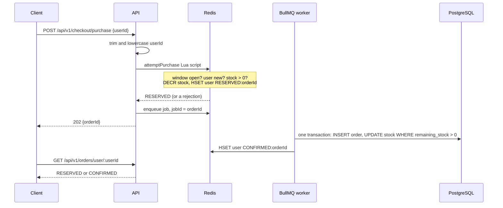

# Flash sale system

A flash sale that sells one limited product to many buyers at once. Each buyer gets at most one unit, and the sale never sells more units than it has. The API is NestJS on Fastify. Redis decides who gets a unit, PostgreSQL stores the orders, and a BullMQ queue moves each reservation from one to the other. The storefront is React 19 with Tailwind CSS 4, served by nginx in Docker.

Status: all six phases are built. The API covers the purchase path, order lookup, and admin reset (Phases 1 to 3). The React storefront (Phase 4) drives every endpoint from the browser. The stress suite (Phase 5) and the Docker stack (Phase 6) run, with measured results below.

## How a purchase works



One Lua script makes the whole decision inside Redis. It checks the sale window, then whether the user already holds a unit, then the stock. A reservation decrements the stock and records `RESERVED:<orderId>` for the user in the same step. Because Redis runs one script at a time, two buyers can never take the last unit together, and two requests from one user cannot both pass the duplicate check.

The HTTP request ends after the enqueue, so a buyer waits for Redis only, not for PostgreSQL. A worker with concurrency 20 persists the order. It retries 5 times with exponential backoff starting at 300 ms. The worker writes only while the Redis entry still holds its order id, so a job whose reservation was released or wiped by a reset writes nothing. When the last attempt fails, a compensation job with its own retries asks PostgreSQL first. An order that did commit is marked CONFIRMED. Otherwise the reservation is released and the unit returns to the stock.

PostgreSQL is the source of truth. A unique key on `(flash_sale_id, user_id)` and the `remaining_stock > 0` condition stop a duplicate or an extra order even if Redis were wrong. On boot, when the Redis keys for the sale are missing, the API rebuilds them from PostgreSQL. Remaining stock becomes total stock minus confirmed orders.

## HTTP API

All routes except `/health` live under `/api/v1`.

| Method | Path | Result |
| --- | --- | --- |
| `GET` | `/health` | 200 when PostgreSQL and Redis answer, 503 otherwise |
| `GET` | `/api/v1/products/featured` | The product on sale |
| `GET` | `/api/v1/flash-sales/current` | Sale state (`UPCOMING`, `ACTIVE`, `SOLD_OUT`, `ENDED`), stock, window. Cached for 200 ms |
| `POST` | `/api/v1/checkout/purchase` | Body `{ "userId": "..." }`. Outcomes below |
| `GET` | `/api/v1/orders/user/:userId` | `NONE`, `RESERVED` or `CONFIRMED`, with the `orderId` |
| `POST` | `/api/v1/admin/flash-sales/reset` | Demo tool. Body `{ totalStock?, startsOffsetSeconds?, durationSeconds?, productName? }`. Returns 404 when `ENABLE_ADMIN_ENDPOINTS=false` |

| Purchase outcome | Status | `code` |
| --- | --- | --- |
| Unit reserved | 202 | `RESERVED` |
| User already holds a unit | 409 | `ALREADY_PURCHASED` |
| No stock left | 410 | `SOLD_OUT` |
| Sale not started, or over | 422 | `SALE_UPCOMING`, `SALE_ENDED` |
| User id is not 3 to 128 characters of `a-z 0-9 . _ @ + -` after trimming and lowercasing | 400 | `INVALID_USER_ID` |
| Redis or the queue failed | 503 | `TEMPORARY_FAILURE` |

The API trims and lowercases user ids, so `" Alice@Example.com "` and `alice@example.com` are the same buyer.

## The storefront

The page at `/` has five parts, one per feature module in `apps/web/src/modules/`.

| Module | What the buyer sees |
| --- | --- |
| `product` | The product card with its SKU, a "Limited Edition" badge, "Limit 1 Per Customer", the flash price, the struck-through original price and the discount |
| `flash-sale` | The `Sale status` card with a color-coded state pill, a countdown to the start or the end, and an animated stock bar |
| `checkout` | The `Checkout` card with a user id field, a "Random Test User" button and "Buy Now", plus a banner for each outcome |
| `orders` | The `Order lookup` card, and the confirmation poller that turns a reservation into a receipt |
| `simulation` | The "Demo scenarios" toolbar at the bottom of the page, for reviewers |

The status card polls `GET /api/v1/flash-sales/current` every 2 seconds. The countdown does not trust the browser clock. Each response carries `serverTime`, and the page counts down from `serverTime` plus the time elapsed since, so a laptop clock that is hours off still shows the right seconds.

"Buy Now" is locked while the sale is not `ACTIVE`, while a request is in flight, and while the user id is blank. After a 202 the checkout card polls `GET /api/v1/orders/user/:userId` every 400 ms. It stops on the first answer that ends the wait. `CONFIRMED` shows a verified receipt with the order id. `NONE` means the reservation was released, by compensation or a reset. After 75 attempts (about 30 seconds) the card says the order is still confirming and points to the lookup card. 409, 410 and 422 each get their own banner with the server's message.

The scenario toolbar resets the sale through the admin endpoint with four presets: an active sale with 100 units for an hour, high scarcity with 3 units, a sale that starts in 15 seconds, and one that ended an hour ago. The reset response goes straight into the status card, so the page switches without waiting for the next poll. The checkout and lookup cards remount, which drops stale banners and pollers.

The page calls relative `/api/v1` paths. In development Vite proxies `/api` and `/health` to the API, and in Docker nginx does, so the API needs no CORS.

## Run it locally

You need pnpm 12, Node 22.22 or 24.15 or later (pnpm 12 refuses older Node), and Docker.

```sh
cp .env.example .env          # change POSTGRES_PORT or REDIS_PORT if those ports are taken
docker compose up -d postgres redis
pnpm install
pnpm --filter @flash-sale/api build
pnpm --filter @flash-sale/api start
```

The API creates its tables on boot, seeds the sample product and a sale that is open for 24 hours with 100 units, and listens on `PORT` (3000 by default).

```sh
pnpm --filter @flash-sale/web dev   # http://localhost:5173, proxies /api and /health to http://127.0.0.1:3000
VITE_API_PROXY_TARGET=http://127.0.0.1:3001 pnpm --filter @flash-sale/web dev   # when the API runs on another port
```

## Run the full stack in Docker

```sh
docker compose up -d --build --wait   # postgres, redis, api, web
curl localhost:3000/health            # {"status":"ok","checks":{"database":"up","redis":"up"}}
open http://localhost:8080            # nginx serves the web build and proxies /api and /health to the API
```

`--wait` returns once PostgreSQL, Redis, and the API report healthy. The API's healthcheck calls `/health`, and the web and k6 services start only after it passes. If host port 3000 is taken, run `PORT=3001 docker compose up -d --build --wait` and use port 3001 below. Pass the same `PORT` to every later `docker compose up`, or Compose recreates the API on the default port.

The API image is a two-stage build on `node:24-alpine`. The build stage installs pnpm 12.16.1 with `npm install -g`, runs `pnpm install --frozen-lockfile` for the API's workspace slice, compiles, and runs `pnpm deploy --prod` to copy only production dependencies. The runtime stage holds `dist` and those dependencies, runs as the `node` user, and is 385 MB. The install keeps optional dependencies, so platform packages such as the musl build of `msgpackr-extract` are present and BullMQ's msgpackr reports native acceleration on Alpine. A BuildKit cache mount keeps the pnpm store between builds, so a rebuild after a dependency change downloads only the new packages. The base is Node 24 rather than Node 20 because pnpm 12.16.1 declares `node: ^22.22.2 || ^24.15.0 || >=26.0.0`, and Node 20 left support in April 2026.

## Tests

```sh
pnpm --filter @flash-sale/api test:unit         # no containers needed
pnpm --filter @flash-sale/api test:integration  # needs the postgres and redis containers
pnpm --filter @flash-sale/api test:e2e          # the HTTP end-to-end suites only
pnpm --filter @flash-sale/web test              # Vitest and React Testing Library, no containers needed
pnpm verify                                     # lint, typecheck, build and every test
```

Stop the API container (`docker compose stop api web`) before you run the integration suites or `pnpm verify`. They share the compose PostgreSQL, Redis, and queue name, and a running API container's worker would take the suites' jobs.

The integration suites run against the real PostgreSQL 16 and Redis 7 containers, read the root `.env`, and run one file at a time because they share one queue. The end-to-end suites boot the whole application and drive it over HTTP. Jest exits cleanly under `--detectOpenHandles` without `--forceExit`. On shutdown the worker and queue close before the Redis connection, and `shutdown-order.redis.spec.ts` fails if that order breaks.

The web specs sit in each module's `__tests__/` folder and stub only `fetch`, so every test runs the real HTTP client, hooks and components. Timer behavior (the 2-second status poll, the 400 ms confirmation poll, the countdown under a skewed clock) runs on Vitest's fake timers. The verify skill in `.claude/skills/verify/` also drives the running storefront through Playwright, including a run with the browser clock an hour ahead.

## Concurrency results

These counts come from the Jest end-to-end suite and from early `curl` runs. The stress suite in the next section adds throughput and latency.

| Run | Requests | Result |
| --- | --- | --- |
| `flash-sale-race.e2e-spec.ts`, one Node process | 100 buyers, 10 units | 10 × 202, 90 × 410, 10 orders, `remaining_stock` 0 |
| `flash-sale-race.e2e-spec.ts`, one Node process | 50 requests from one user | 1 × 202, 49 × 409 |
| Live API, 80 parallel `curl` processes | 400 buyers, 10 units | 10 × 202, 390 × 410, Redis stock 0, 10 orders, `remaining_stock` 0 |
| Live API, 80 parallel `curl` processes | 200 requests from one user in 4 case and space variants | 1 × 202, 199 × 409, 1 order |

## Stress tests

Both scenarios live in one table, `tests/stress/scenarios.mjs`, which the k6 scripts and the Node runner import. Each run starts with an admin reset.

| Scenario | Stock | Requests | Concurrency | Pass condition |
| --- | --- | --- | --- | --- |
| `oversell` | 100 | 5,000 distinct buyers | 250 | exactly 100 × 202 and 4,900 × 410, no 409, no 5xx, k6 p95 under 250 ms |
| `same-user-race` | 50 | 300 requests from one buyer in 4 case and whitespace variants | 100 | exactly 1 × 202 and 299 × 409, no 410, no 5xx |

```sh
pnpm stress:k6:oversell     # k6 1.8.3 in a container on the compose network, against the running stack
pnpm stress:k6:same-user
BASE_URL=http://localhost:3000 pnpm stress:node   # both scenarios, then checks PostgreSQL and Redis
```

The k6 scripts run with `--no-deps`, so they hit the stack you started and never recreate it. A broken threshold exits with code 99.

The Node runner uses only Node built-ins. After firing a scenario it polls `GET /api/v1/orders/user/:userId` until every buyer who got 202 is `CONFIRMED`. That means the queue has persisted every reservation. It then reads PostgreSQL and Redis through `docker compose exec` and checks these facts:

- The order ids in PostgreSQL equal the order ids from the 202 responses, with none missing and none extra.
- `remaining_stock` equals `total_stock` minus the orders.
- The Redis stock equals the scenario stock minus the expected reservations.
- The Redis buyer hash holds exactly one `CONFIRMED` entry per reservation.
- Redis stock plus PostgreSQL orders equals the stock.
- In the race, the one order belongs to `stress-racer@example.com`.

It ends with `STRESS OK` or `STRESS FAILED: <checks>` and exit code 1.

Results from 2026-11-20, all on one 4-core WSL2 machine. Docker Desktop ran the stack, so the load generator shared the CPU with the API, Redis, and PostgreSQL. Each burst lasts 1.5 to 2.6 seconds, so throughput includes connection ramp-up.

| Run | Throughput | p50 | p95 | p99 | Counts |
| --- | --- | --- | --- | --- | --- |
| k6 oversell, 2 runs | 3,265 to 3,303 req/s | 36 to 65 ms | 52 to 93 ms | 128 ms to 1.38 s | 100 × 202, 4,900 × 410 |
| k6 same-user, 2 runs | 1,974 to 2,400 req/s | 18 to 19 ms | 85 to 98 ms | 91 to 105 ms | 1 × 202, 299 × 409 |
| Node runner oversell, 3 runs | 1,926 to 2,788 req/s | 65 to 91 ms | 110 to 185 ms | 0.8 to 1.2 s | 100 × 202, 4,900 × 410, all store checks pass |
| Node runner same-user, 3 runs | 2,097 to 2,779 req/s | 34 to 45 ms | 50 to 61 ms | 53 to 66 ms | 1 × 202, 299 × 409, all store checks pass |

Runs right after the API container starts are slower while the JIT warms up. The second Node runner pass after a restart measured oversell at 1,603 req/s with p95 284 ms, and still passed every count and store check.

How to read the latency numbers:

- **k6 owns the p95 budget.** The Node runner reports latency but does not gate on it. A single Node process with 250 requests in flight queues its own responses, and that wait lands in what it measures. Against the same server, `fetch` measured p95 at 380 to 690 ms and `node:http` at 125 to 259 ms. Measured p95 tracked the client's event-loop delay in every run, so the runner prints that delay next to its numbers.
- **The p99 tail comes from the opening wave.** In two traced k6 runs, the 94 and 143 requests slower than 500 ms all started in the first 100 ms, while 250 connections opened at once, and all got 410. Every 202 finished within 180 ms. The API container's kernel counted no listen-queue overflows and no SYN retransmits. A `node:http` client firing the same wave inside the compose network saw no request above 500 ms. The cause is not isolated.

Fault injection shows the checks can fail. A stray order row inserted into PostgreSQL mid-run failed the order-id, `remaining_stock`, and conservation checks. In a second run, one unit added to the Redis stock after the sale sold out made the API reserve 101 units. PostgreSQL refused the 101st order through its `remaining_stock > 0` guard, the compensation job returned the unit, and the runner failed six checks. Editing the k6 table to expect 99 reservations, or setting the budget to 1 ms, failed the matching threshold.

## Design decisions

- **Rejections are values.** `CheckoutService.attemptPurchase` returns a discriminated union for the five business outcomes and throws only for infrastructure faults. Sold out and duplicate are the common case under load, and an exception would capture a stack trace for each one. The controller maps the outcome to a status through an exhaustive table, so a new outcome without a status fails the build.
- **A normalized user id is its own type.** `NormalizedUserId` is a branded string. Only the normalizer and the order repository's row mapper can create one, so a raw id cannot reach a service or repository without a compile error.
- **The Redis wire format stays in one file.** Only the Lua scripts and `order-cache.repository.ts` know about `RESERVED:<orderId>` and `CONFIRMED:<orderId>`. Every other layer sees a typed `{ status, orderId }`.
- **The order id is the job id.** BullMQ refuses custom job ids that contain `:`, so `saleId:userId` cannot work. The order id is unique per reservation, so the same user can buy again after a reset without colliding with an old job.
- **Rollback is scoped to one order.** The rollback script releases a unit only while the entry still equals `RESERVED:<orderId>`. Repeating it, or running it after the order was confirmed or the user reserved again, changes nothing.
- **The module graph has no cycles.** Checkout depends on orders, and admin depends on products, flash sales and orders. Rollback lives in the orders module, so orders never needs checkout.
- **The browser treats rejections as values too.** The web HTTP client never throws. It returns `{ ok: true, data }` or `{ ok: false, status, error }`, and a network failure becomes status 0 with `NETWORK_ERROR`. Hooks hold their state in discriminated unions such as `idle | loading | success | error`, so a component cannot render a receipt and an error at once.
- **One polling primitive.** `usePolling` runs a task, waits for it to finish, then schedules the next run, so a slow response never overlaps the next request. The task returns `continue` or `stop`, which ends confirmation polling on the response that says `CONFIRMED`, not one render later.
- **Web modules talk through their barrels.** A module imports another only through its `index.ts`, and a lint rule fails any deeper import. Checkout imports the confirmation poller from orders, the same direction as the API's checkout to orders edge.

## Known limits and tradeoffs

- **An unclear enqueue releases the reservation.** When `queue.add` fails, the API looks the job up by its order id. It keeps the reservation only if the job exists. Otherwise it releases the reservation and answers 503, and a job that was stored after all finds its reservation gone and writes nothing. One race is left. If the reply was lost, the lookup failed too, and a worker picked the job up just before the release, that job still writes its order. Redis then offers one unit more than PostgreSQL holds, so the buyer who takes it gets 202 and is released later.
- **Compensation needs Redis to start.** The worker queues the compensation job when the last attempt fails. If Redis is unreachable at that moment, nothing can be queued, the reservation stays held, and the API logs an error. The same holds when the compensation job uses up its 8 retries. An admin reset clears the held unit.
- **Boot hydration is a check and then a write.** It is not atomic across several API instances. It runs once per boot, before the server accepts requests, and the compose stack runs one API instance.
- **Reset is a demo tool.** It pauses the persistence queue, waits up to 10 seconds for jobs in flight (503 if they do not finish), discards the waiting and delayed jobs, rebuilds the sale, and resumes the queue. If the process dies in the middle, the next boot resumes the queue. A purchase that reserves against the old state while the reset runs gets 202, but its job finds the reservation gone, so that buyer ends with no order. The reset has no authentication beyond the `ENABLE_ADMIN_ENDPOINTS` switch. `productName` changes only the cached sale, not the stored product.
- **The system runs one sale.** The active sale id is a constant.
- **The storefront polls instead of being pushed to.** Sale status can be up to 2 seconds old, plus the 200 ms server cache. When stock runs out, "Buy Now" stays enabled until the next poll, and a click in that gap gets the 410 banner. Server-sent events would close the gap at the cost of a connection per open page.
- **The countdown offset can be up to 200 ms off.** It comes from `serverTime`, and a status served from the 200 ms cache carries the time it was computed.

## Repository layout

```text
apps/api/src/
  common/            user id normalizer and pipe, clock, error filter
  config/            environment validation
  infrastructure/    database, redis (with the Lua scripts), queue
  modules/
    products/        featured product
    flash-sales/     sale status and campaign rows
    checkout/        purchase endpoint and the Redis gatekeeper
    orders/          persistence queue, worker, lookup, Redis order ledger
    admin/           boot hydration and reset
apps/api/test/
  unit/              one spec per class, collaborators mocked
  integration/       real PostgreSQL and Redis; *.e2e-spec.ts boot the whole app
apps/web/src/
  app/               App shell, layout, error boundary
  shared/            HTTP client, polling hook, Card, Alert, StatusPill, currency format
  modules/           product, flash-sale, checkout, orders, simulation; each has
                     api/, hooks/, components/, types/, constants/, __tests__/ and an index.ts barrel
tests/stress/        scenario table, k6 scripts, zero-dependency Node runner
```

Engineering rules (test-first development, layering, size limits) are in [AGENTS.md](AGENTS.md).
