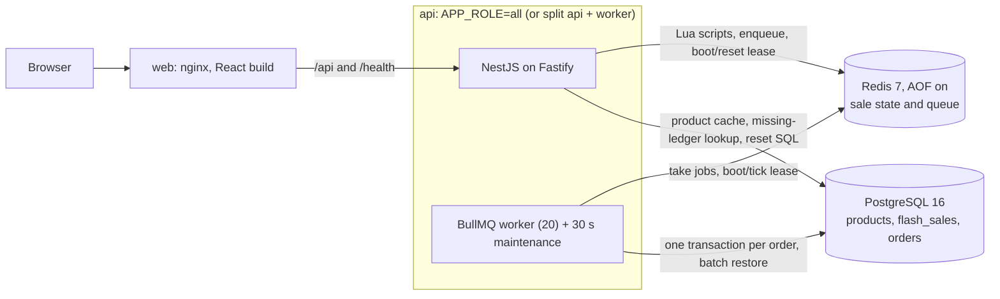
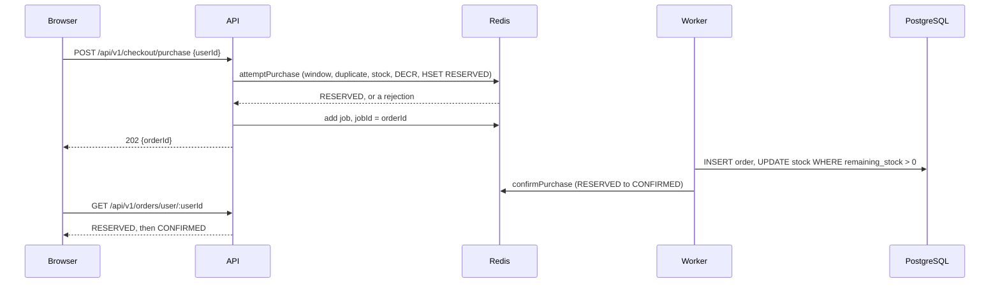
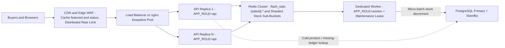

# Flash sale system

A flash sale API and storefront that sell one limited product to many buyers at once, with at most one unit per buyer and never more units sold than stock. NestJS on Fastify answers from Redis, a BullMQ queue writes each order to PostgreSQL, and a React storefront served by nginx drives every endpoint.

## Quick start

You need Docker with Compose v2.

```sh
cp .env.example .env
docker compose up -d --build --wait   # postgres, redis, api, web
curl localhost:3000/health            # {"status":"ok","checks":{"database":"up","redis":"up"}}
open http://localhost:8080            # the storefront
```

Ports 3000 (API), 8080 (web), 5432 and 6379 bind to `127.0.0.1` only. `PORT`, `WEB_PORT`, `POSTGRES_PORT` and `REDIS_PORT` in `.env` change them. On first boot the API creates its tables and seeds one product and a sale that opens now, runs 24 hours and holds 100 units. The "Demo scenarios" toolbar at the bottom of the page resets the sale into four states.

## Documentation

This page is the overview. Each topic below has its own page, with diagrams.

| Page | What it covers |
| --- | --- |
| [Architecture](docs/architecture.md) | Components, who owns which data, Redis keys and scripts, the schema, the module graph, boot and shutdown, the frontend |
| [Purchase flow](docs/purchase-flow.md) | One purchase from the click to the PostgreSQL row, stage by stage |
| [Fault tolerance](docs/fault-tolerance.md) | Each fault, its mechanism, the recovery time and the test that proves it |
| [Design decisions](docs/design-decisions.md) | 16 decisions, each with the alternative rejected and the cost |
| [Scaling and limits](docs/scaling.md) | What limits throughput, what was measured, the path to several instances |
| [HTTP API](docs/api.md) | Every endpoint with real responses, and the error codes |
| [Testing](docs/testing.md) | The test levels, what each proves, the static checks and the gate |
| [Benchmarks](docs/benchmarks.md) | The stress scenarios, the results, the method and the caveats |
| [Development guide](docs/development.md) | Run, configure, try it by hand, troubleshoot |

## How the brief is met

| The brief asks for | How | Where to look |
| --- | --- | --- |
| A configurable sale window | `SALE_STARTS_AT`, `SALE_ENDS_AT`, and the reset endpoint. The gate checks the window with the server clock, inclusive at both ends | [Purchase flow](docs/purchase-flow.md#stage-2-the-gate) |
| One product, limited stock | `SALE_TOTAL_STOCK`. Redis decrements stock only above zero, and PostgreSQL refuses an order past it | [Architecture](docs/architecture.md#who-owns-which-data) |
| One item per user | The gate rejects a buyer with an entry, ids are normalized, and `UNIQUE (flash_sale_id, user_id)` backs it | `same-user-race`: 300 requests, 1 × 202 |
| Status, purchase and lookup endpoints | `GET /flash-sales/current`, `POST /checkout/purchase`, `GET /orders/user/:userId` | [HTTP API](docs/api.md) |
| A simple React frontend | The storefront on port 8080 shows the status, takes a user id, and answers every outcome | [Architecture](docs/architecture.md#frontend) |
| A system diagram | The diagram below, and a fuller one in the architecture page | [Architecture](docs/architecture.md#system-context) |
| High throughput | One Lua call and one enqueue per purchase, and no database write on the request path | [Benchmarks](docs/benchmarks.md), [Scaling](docs/scaling.md) |
| Robustness | Retries, compensation, a 30 s sweep and a restore from PostgreSQL | [Fault tolerance](docs/fault-tolerance.md) |
| No overselling under concurrency | One atomic script plus PostgreSQL's guards | `oversell`: 5,000 buyers, 100 units, exactly 100 × 202 |
| Unit and integration tests | 473 API unit, 196 web, 66 script tests, plus 31 API integration and end-to-end suites | [Testing](docs/testing.md) |
| Stress tests, and an explanation | Five scenarios (`oversell`, `same-user-race`, `mixed`, `pg-blip`, plus opt-in `realistic-mix` through nginx) | [Benchmarks](docs/benchmarks.md) |

## Architecture



By default (`APP_ROLE=all`), one process serves HTTP and runs the worker. Passing `APP_ROLE=api` and `APP_ROLE=worker` (preconfigured in `docker-compose.scaled.yml`) splits HTTP replicas from the background worker and 30 s maintenance loop; boot hydration, maintenance ticks, and admin resets all coordinate across instances using the Redis lease `flash_sale:{id}:maintenance_lock` (25 s TTL, atomic `releaseLock`). Redis holds the live sale in cluster-safe `{id}`-tagged keys: `flash_sale:{id}:config` (window and total stock), `:stock` (units left), `:users` (buyer to `RESERVED:<orderId>` or `CONFIRMED:<orderId>`), and `:maintenance_lock`, plus the BullMQ queue. PostgreSQL holds products, the sale row, and the orders, and is the source of truth for orders. Confirmed orders are restored to Redis in batches of 1,000 using keyset pagination (`idx_orders_sale_status_created`). On reads, `ProductsService` caches the featured product in memory for 60 s (with singleflight coalescing, `Cache-Control: public, max-age=60, stale-while-revalidate=300`, and stale `lastKnownProduct` fallback once warm if PostgreSQL is down), `FlashSalesService` caches the Redis snapshot for 200 ms (recomputing `serverTime` and `saleState` fresh per request), and `OrdersService` checks both `:users` and ledger intactness (`EXISTS` on config and stock) in one `MULTI` so non-buyer lookups return `NONE` without querying PostgreSQL while the ledger is intact. nginx pools up to 256 keepalive connections (`keepalive_requests 10000`) to the API, overwrites `X-Forwarded-For` with `$remote_addr` for `TRUST_PROXY=true`, enables gzip compression and security headers (`X-Content-Type-Options`, `X-Frame-Options`, `Referrer-Policy`), and proxies `/api/` and exact `/health` (never `/metrics`), so the browser uses relative paths and the API needs no CORS.

Each API module lives in `apps/api/src/modules/<domain>/` with controllers, services, repositories, DTOs, interfaces and constants. The module graph is acyclic, with no `forwardRef()`. An arrow means "imports".

```text
Checkout -> Common, SaleLedger, Orders, Metrics    Orders -> Common, SaleLedger, Metrics, queue
FlashSales -> Common, SaleLedger, TypeORM          Admin -> Common, Products, FlashSales, Orders, SaleLedger
Products -> Common, TypeORM    Health -> Redis     SaleLedger -> Redis
```

`modules/sale-ledger` is the only code that knows a sale's Redis keys, entry formats and Lua scripts (`attemptPurchase`, `rollbackPurchase`, `confirmPurchase`, `restoreSale`, `restoreConfirmedBatch`, `adoptOrder`, `releaseLock`). Other modules call `SaleLedgerRepository` and `SaleLedgerLeaseRepository` and get typed results, never `"RESERVED:<id>"`. Services return expected outcomes such as sold out as values and throw only for infrastructure faults. Time comes from an injectable `ClockService`. The web app has five feature modules (`product`, `flash-sale`, `checkout`, `orders`, `simulation`) that import each other only through their `index.ts`.

## How a purchase works



The API trims and lowercases the user id, then runs `attemptPurchase`, one Lua script. It answers a resend of the same order id with `RESERVED`, then checks the sale window (using the API's clock time), whether the buyer already holds an entry, and whether stock is above zero. A reservation decrements stock and writes `RESERVED:<orderId>` in the same script. Redis runs one script at a time, so two buyers cannot take the last unit and two requests from one buyer cannot both pass.

The API then adds one job per reservation and answers 202 without waiting for PostgreSQL. If the enqueue reply is lost but the job is stored, the buyer still gets 202. If the job is not stored, the API releases the reservation and answers 503. The worker skips a job whose reservation was released or replaced. Otherwise it inserts the order and decrements `remaining_stock` in one transaction, then runs `confirmPurchase`, which writes `CONFIRMED` only while the entry still holds `RESERVED:<orderId>`. If PostgreSQL holds the order but its Redis entry is gone, `adoptOrder` writes `CONFIRMED` and takes the unit.

- **No oversell.** Redis decrements stock only above zero. PostgreSQL refuses an order when `remaining_stock > 0` fails, and `CHECK` constraints bound the column.
- **One unit per buyer.** The script rejects a buyer who has an entry. PostgreSQL has `UNIQUE (flash_sale_id, user_id)`.
- **Every 202 ends as an order or a released unit.** Retries, compensation and the maintenance sweep below close the gap between a reservation and its order.

## Failure behavior

The mechanism, the time bound and the proving test for each row, with more faults, are in [Fault tolerance](docs/fault-tolerance.md).

| Fault | What the buyer sees | How it heals | How long |
| --- | --- | --- | --- |
| PostgreSQL down | Purchases still answer 202. Lookups while the Redis ledger is intact still answer `200 NONE` / `RESERVED` / `CONFIRMED`; lookups when ledger keys are missing answer `503 TEMPORARY_FAILURE`. Featured product reads serve the cached/stale `lastKnownProduct` once warm (cold cache answers `503`). `/health` answers 503. | The worker retries each job every 2 s, up to 150 attempts. The pool times out connects at 2 s and statements at 5 s. `GlobalExceptionFilter` maps PostgreSQL unavailability to `503 TEMPORARY_FAILURE`. | Orders confirm if PostgreSQL returns within about 5 minutes. After that a compensation job releases the unit once PostgreSQL answers, and the lookup shows `NONE`. |
| Redis unreachable | Every route answers 503 `TEMPORARY_FAILURE` immediately, because the client has no offline queue. A command times out after 2 s, and up to about 4 s was observed under pipelined load. | The client reconnects in 50 ms steps, capped at 2 s. Queued jobs survive in Redis through AOF. | Normal on reconnect. |
| Redis fails after the reserve script ran | 503 for that request. A retry by the same buyer gets 409, and other buyers can get 410 while stock is free. | The sweep releases a `RESERVED` entry with no pending job when it sees it on two consecutive ticks. | 30 to 60 s |
| API crash | Connection errors. | `restart: unless-stopped` restarts it after a crash, but not after `docker stop` or `docker kill`. On boot it acquires `flash_sale:{id}:maintenance_lock` (up to 50 × 100 ms retries, skipping with a warning if busy) to restore missing keys and run the boot sweep per `APP_ROLE`: `all` sweeps at threshold 1 (`BOOT`), `api` skips boot sweeping (`null`), and `worker` sweeps at threshold 2 (`INTERVAL`) so live `api` enqueues are not dropped. BullMQ reruns a job that was active. | About a minute (30 s job lock plus a 30 s stall check) |
| Redis data lost (`FLUSHALL`) | Purchases answer 503. Status answers 404 `FLASH_SALE_NOT_FOUND`. | Every 30 s the maintenance loop acquires `flash_sale:{id}:maintenance_lock` (25 s TTL), restores missing config, stock and `CONFIRMED` entries from PostgreSQL in 1,000-row keyset batches (`restoreConfirmedBatch`), and never wipes live reservations. In-flight jobs whose orders already committed to PostgreSQL adopt cleanly (`adoptCommittedOrStale` + retry while `!isIntact`); reservations and jobs that existed only in Redis are gone, so those 202s never become orders and their units return to stock. | Within one tick |
| Worker stalls (event loop blocked past the 30 s job lock) | Nothing. The 202 stands. | BullMQ requeues the job. A job that stalls twice fails and is compensated. Compensation checks PostgreSQL, then confirms or releases. | 30 to 60 s |
| Reset fails after PostgreSQL committed | The reset call answers an error. Because `invalidateState` deletes Redis keys before SQL commits, Redis no longer serves the old sale (`404` on status, `503` on purchase). | In `APP_ROLE=all`, the next tick finishes the in-memory `pendingPlan` (or heals via `restoreIfLost` after a restart). In split `api` + `worker` mode, `worker`'s next tick heals Redis from the committed PostgreSQL row via `restoreIfLost` even if `api` restarts. | Up to 30 s |

## HTTP API

All routes except `/health` and `/metrics` live under `/api/v1`. Request and response examples are in [the API page](docs/api.md).

| Method | Path | Result |
| --- | --- | --- |
| `GET` | `/health` | 200 when PostgreSQL and Redis answer within 1 s, otherwise 503 |
| `GET` | `/metrics` | Internal Prometheus text endpoint (API/worker internal port `3000`; not proxied by nginx — `:8080/metrics` falls through to SPA `index.html`, and `docker-compose.scaled.yml` does not publish port `3000`). Exports `flash_sale_purchase_attempts_total`, `flash_sale_order_persistence_total`, and `flash_sale_order_queue_jobs` |
| `GET` | `/api/v1/products/featured` | The product on sale (60 s singleflight cache, `Cache-Control: public, max-age=60, stale-while-revalidate=300`) |
| `GET` | `/api/v1/flash-sales/current` | `saleId`, `saleState` (`UPCOMING`, `ACTIVE`, `SOLD_OUT`, `ENDED`), stock, window and `serverTime`. Redis snapshot cached for 200 ms (`serverTime` and `saleState` computed fresh per request) |
| `POST` | `/api/v1/checkout/purchase` | Body `{ "userId": "..." }`. Outcomes below (optional per-IP rate limit via `RATE_LIMIT_ENABLED`) |
| `GET` | `/api/v1/orders/user/:userId` | `userId`, `hasPurchased`, `status` (`NONE`, `RESERVED`, `CONFIRMED`) and `orderId` (optional per-IP rate limit) |
| `POST` | `/api/v1/admin/flash-sales/reset` | Demo tool. `404` unless `ENABLE_ADMIN_ENDPOINTS=true`; `401 UNAUTHORIZED` when `ADMIN_API_KEY` is set and `x-admin-key` does not match |

| Purchase outcome | Status | `code` |
| --- | --- | --- |
| Unit reserved | 202 | `RESERVED` |
| Buyer already holds a unit | 409 | `ALREADY_PURCHASED` |
| No stock left | 410 | `SOLD_OUT` |
| Sale not started, or over | 422 | `SALE_UPCOMING`, `SALE_ENDED` |
| User id is not 3 to 128 characters of `a-z 0-9 . _ @ + -` after trimming and lowercasing | 400 | `INVALID_USER_ID` |
| Request body exceeds 16 KiB limit | 413 | `PAYLOAD_TOO_LARGE` |
| Rate limit exceeded (when `RATE_LIMIT_ENABLED=true`) | 429 | `RATE_LIMITED` |
| Redis, PostgreSQL, or the queue failed, or the stock key is missing | 503 | `TEMPORARY_FAILURE` |

The reset body is `{ totalStock?, startsOffsetSeconds?, durationSeconds?, startsAt?, endsAt? }`. `startsAt` and `endsAt` are ISO-8601 timestamps and cannot be mixed with the relative fields. Absent fields fall back to the configured sale. Unknown fields, including `productName`, answer 400. Reset acquires `flash_sale:{id}:maintenance_lock` (up to 20 × 100 ms retries, `503` if busy), pauses and drains the queue, deletes Redis ledger keys (`invalidateState`), drops the sale's orders and reschedules the row in one SQL statement, replaces Redis state, drops the 200 ms status cache, and resumes the queue in `finally`. It also answers 503 if jobs in flight do not finish within 10 s.

Configuration lives in `.env`, which `.env.example` documents:

- **Process role & scaling:** `APP_ROLE` (`all` default, `api`, or `worker`) selects whether HTTP routes, the BullMQ worker + maintenance timer, or both run in the process.
- **Admin, proxy trust & rate limiting:** `ENABLE_ADMIN_ENDPOINTS` (`false` in code, `true` in `.env.example` and Compose), `ADMIN_API_KEY` (optional `x-admin-key` secret), `TRUST_PROXY` (`false` in code and `.env.example`, `true` default in Compose behind nginx's `X-Forwarded-For $remote_addr`), and `RATE_LIMIT_ENABLED` (`false` default), `RATE_LIMIT_WINDOW_MS` (`60000` default, 1 s–1 h), `RATE_LIMIT_MAX` (`60` default, 1–100,000).
- **Sale window and stock:** `SALE_STARTS_AT`, `SALE_ENDS_AT` and `SALE_TOTAL_STOCK`. With them unset, the first boot seeds now, now plus 24 h and 100 units, and a restart never moves a stored sale. With them set, a restart rewrites only the parts you set, and only while the sale has no order and no ledger entry. An invalid value stops the boot with a message naming the variable. Every variable is described in [the development guide](docs/development.md#configuration).

## Testing

Development is test first, and each level proves something the cheaper levels cannot.

| Level | Location | Runs against |
| --- | --- | --- |
| API unit | `apps/api/test/unit/` | One class, collaborators mocked, clock pinned |
| API integration | `apps/api/test/integration/*.spec.ts` | Real PostgreSQL 16, Redis 7 and BullMQ |
| API end to end | `apps/api/test/integration/*.e2e-spec.ts` | The whole app over HTTP, including 100 buyers on 10 units and 50 requests from one buyer |
| Web | `apps/web/src/**/__tests__/` | Vitest and React Testing Library, only `fetch` stubbed |
| Architecture check | `scripts/*.test.mjs` | `node --test` against fixture sources |

`pnpm verify` prints one `PASS` or `FAIL` line for each of nine steps, then `VERIFY OK` or `VERIFY FAILED`. The steps are the healthy `postgres` container, the healthy `redis` container, `pnpm lint`, `pnpm test:scripts`, `pnpm -r typecheck`, a stopped compose `api` container, every API Jest suite under `--detectOpenHandles` within 300 s, the web Vitest suite and `pnpm -r build`. The `api` step exists because the container's worker would consume the integration suites' jobs, so run `docker compose stop api web` first.

`pnpm lint` runs Biome with `--error-on-warnings`, then `node scripts/arch-check.mjs`, which walks every source file with the TypeScript compiler API. It fails when a controller injects storage, a service calls Redis or SQL, any file calls `forwardRef`, code outside the ledger module touches the Redis client, a web module imports another's internals, or a file or function passes the size limits. The repository has no exceptions. [The testing page](docs/testing.md#static-checks) lists every rule. GitHub Actions ([`.github/workflows/ci.yml`](.github/workflows/ci.yml)) runs both `quality-and-unit` (`lint`, `test:scripts`, `typecheck`, API unit, web tests, `build`) and `api-integration` (against PostgreSQL 16 and Redis 7) on pushes to `main` and pull requests.

The stress suite runs against the compose stack with `pnpm stress:node`, which needs Node 24 and `BASE_URL` (default `http://localhost:3000`; pass `ADMIN_API_KEY` if set). It runs the four default scenarios, resets the sale before each, and checks PostgreSQL and Redis afterwards (order ids equal the 202 ids, `remaining_stock`, Redis stock, conservation). It prints 53 `PASS` lines and `STRESS OK`.

| Scenario | Load | Expected |
| --- | --- | --- |
| `oversell` | 100 units, 5,000 buyers, 250 concurrent | 100 × 202, 4,900 × 410 |
| `same-user-race` | 50 units, 300 requests from one buyer in 4 spellings, 100 concurrent | 1 × 202, 299 × 409 |
| `mixed` | 100 units, 2,000 buyers sending 3 requests each, 250 concurrent | 100 × 202, 200 × 409, 5,700 × 410 |
| `pg-blip` | 3 units, 100 buyers, 25 concurrent, PostgreSQL stopped for 45 s | 3 × 202 all confirmed within 90 s, 97 × 410 |
| `realistic-mix` (opt-in) | Through nginx: 250 buyers (5,000 requests) + 50 storefront readers (8 s) + 30 order lookups (8 s) | 100 × 202, 4,900 × 410, 0 read/lookup failures, 0 × 5xx |

**Warning.** `pg-blip` runs `docker compose stop postgres` for 45 s. Run it only against a stack you own, and keep `RATE_LIMIT_ENABLED=false` during stress runs. `pnpm stress:node:mixed` and `pnpm stress:node:pg-blip` run one scenario. `pnpm stress:k6:oversell`, `pnpm stress:k6:same-user`, and `pnpm stress:k6:realistic` run the k6 scenarios in a container (`realistic` targets nginx at `http://web:80`) and exit 99 when a threshold fails. If `ADMIN_API_KEY` is set in `.env`, pass `-e ADMIN_API_KEY=<secret>` to `docker compose run --rm --no-deps ... k6` (and `-e BASE_URL=http://web:80` for `realistic-mix.k6.js`), because the Compose `k6` service sets only `BASE_URL: http://api:3000`.

## Benchmark

k6, 20,000 purchase requests from 250 virtual users on 100 units. Median of 6 interleaved runs per side, comparing the baseline implementation ("before") and the current implementation ("current") on one machine on the same day.

| Metric | Before | Current | Change |
| --- | --- | --- | --- |
| API CPU per request | 322 µs [304 to 463] | 222 µs [208 to 443] | -31% |
| Throughput | 3,119 req/s [1,802 to 3,227] | 4,486 req/s [2,159 to 4,786] | +44% |
| p50 latency | 63.6 ms | 39.7 ms | -38% |
| p99 latency | 127 ms [102 to 253] | 121 ms [115 to 208] | no measurable difference |

The gain comes from auto-pipelining the hot-path Redis client and dropping request logs on the three hot routes. The durability work cost no measurable throughput or p99, and about 6% more Redis CPU. The machine is WSL2 on 4 vCPUs (2 cores with SMT) shared by the load generator, API, Redis and PostgreSQL, and its load average never fell below 1.0, so only the interleaved comparison counts. Every run returned exactly 100 × 202 and 19,900 × 410 with no 5xx. A separate 6-run steady `realistic-mix.k6.js` series through nginx (`http://web:80`) combining 250 buyers, 50 storefront readers, and 30 order lookups recorded medians of 1,518.0 buyer req/s (p95 236.6 ms, p99 289.2 ms), 1,261.6 read req/s (p99 135.1 ms), and 489.7 lookup req/s (p99 187.9 ms) with all thresholds passing, zero 5xx, and zero read/lookup failures. Method, full tables and caveats are in [docs/benchmarks.md](docs/benchmarks.md).

## Scaling to Production (10x–100x Load)

The repository ships a ready split topology in [`docker-compose.scaled.yml`](docker-compose.scaled.yml) (`APP_ROLE=api` + `APP_ROLE=worker`) and Redis Cluster hash-tagged keys (`flash_sale:{saleId}:*`). Reaching 10x–100x sustained load builds on that base:



- **Split stateless API replicas from the worker (`docker-compose.scaled.yml`).** Running `docker compose -f docker-compose.yml -f docker-compose.scaled.yml up -d --scale api=N` runs stateless `APP_ROLE=api` replicas for HTTP only and a dedicated `APP_ROLE=worker` container for BullMQ persistence and the 30 s maintenance loop. Boot hydration, maintenance ticks, and admin resets all coordinate across instances using the Redis lease `flash_sale:{id}:maintenance_lock` (`25 s` TTL, released atomically via `releaseLock`).
- **Redis Cluster `{saleId}` hash tags and sharded stock sub-buckets.** All ledger keys already share `{saleId}`, guaranteeing single-slot Lua execution on Redis Cluster across many concurrent sales. To push a single massive flash sale past one Redis shard's core ceiling, split stock into `K` sub-buckets (`flash_sale:{saleId:0}:stock`..`flash_sale:{saleId:K-1}:stock`) routed by user hash, with a fallback/rebalance step as buckets empty.
- **PostgreSQL hot-row mitigation on `flash_sales.remaining_stock`.** Currently every confirmed order runs `UPDATE flash_sales SET remaining_stock = remaining_stock - 1 ...`, serializing row locks on the single sale row. At 10x–100x write volume, batch `N` order inserts in a worker transaction and apply one `remaining_stock = remaining_stock - N` decrement (micro-batching) or derive remaining stock from partitioned counters.
- **CDN / edge caching for product and sale status.** `GET /api/v1/products/featured` already emits `Cache-Control: public, max-age=60, stale-while-revalidate=300` and collapses concurrent DB misses via a 60 s singleflight cache. Put a CDN in front of `/products/featured` and short-TTL edge caching (e.g. `s-maxage=1`) in front of `/flash-sales/current` so read storms never hit origin API pods.
- **Distributed rate limiting.** Built-in `RateLimitGuard` (`RATE_LIMIT_ENABLED=true`, keyed by `request.ip` under `TRUST_PROXY` with nginx overwriting `X-Forwarded-For $remote_addr`) stores up to 50,000 fixed-window buckets per process in memory (O(1) expired-slot eviction). With multiple `APP_ROLE=api` replicas behind a load balancer, enforce global rate limits and bot filtering at the edge/API gateway or in a shared Redis sliding-window limiter keyed on authenticated user id and IP.

See [Scaling and limits](docs/scaling.md) for measured resource headroom and what is already built versus future work.

## Trade-offs and known limits

The reasons behind the choices are in [Design decisions](docs/design-decisions.md), and what changes when scaling further is in [Scaling and limits](docs/scaling.md).

- **Single-process default (`APP_ROLE=all`), with split mode (`APP_ROLE=api|worker`) built in.** One process is simplest for local runs, though the worker shares the Node event loop and one main thread caps purchase throughput (~4,486 req/s on 1 core). `docker-compose.scaled.yml` separates HTTP replicas from the worker and coordinates boot hydration, ticks, and resets via `flash_sale:{id}:maintenance_lock` (and split resets recover via pre-SQL `invalidateState` + worker `restoreIfLost`), while `OrphanSweeper.strikes`, `MetricsService` counters, `ProductsService` (60 s) / `FlashSalesService` (200 ms) caches, `RateLimitService` buckets, and `ClockService` skew remain per-process.
- **Persistence retries last about 5 minutes.** A PostgreSQL outage longer than that withdraws the 202. The unit is released and the lookup shows `NONE`. A deterministic rejection (sale row missing, stock guard) compensates after one attempt.
- **The sweep takes 30 to 60 s.** After a Redis fault between the reserve and the enqueue, the buyer got 503 but the unit stays held until the sweep. Answering 202 instead would promise an order that has no job.
- **Redis loses up to about a second of writes** on a crash with AOF `everysec`. The PostgreSQL unique key and stock guard still refuse a duplicate or an extra order.
- **Some faults go undetected.** Losing only the `users` hash while config and stock remain is not noticed. A compensation can race a live persist only if the event loop blocks longer than the 30 s job lock. If an enqueue reply is lost, the job lookup also fails, and the order then commits, the buyer sees 503 but owns the order. A retry answers 409.
- **Polling, not push.** The status can be up to 2 s old plus the 200 ms cache. "Buy Now" enables within 250 ms of the server-corrected start, and the server stays the arbiter, so an early click gets `SALE_UPCOMING`.
- **Rate limiting is opt-in and in-memory.** `RATE_LIMIT_ENABLED` defaults to `false` so single-host stress tests are not throttled with 429s; enabling it enforces per-process per-IP limits on checkout and order lookup (`TRUST_PROXY=true` in Compose trusts nginx's `X-Forwarded-For $remote_addr`; `false` ignores forwarded headers). Multi-replica deployments should use a shared edge or Redis limiter.
- **One sale, and reset is a demo tool.** The active sale id is a constant. Reset is not linearizable with concurrent purchases, and relies on `ENABLE_ADMIN_ENDPOINTS` plus optional `ADMIN_API_KEY` (`x-admin-key`).

## Development without Docker

You need Node 24 or later. `.nvmrc` pins 24, and `pnpm install` fails on an older Node. `packageManager` pins pnpm 12.16.1, which `corepack enable` installs.

```sh
nvm use && corepack enable
cp .env.example .env                  # change POSTGRES_PORT or REDIS_PORT if those ports are taken
docker compose up -d --wait postgres redis
pnpm install
pnpm --filter @flash-sale/api build && pnpm --filter @flash-sale/api start
pnpm --filter @flash-sale/web dev     # http://localhost:5173, proxies /api and /health to 127.0.0.1:3000
```

Set `VITE_API_PROXY_TARGET` when the API runs on another port. Run `pnpm --filter @flash-sale/api test:unit` and `pnpm --filter @flash-sale/web test` without containers. `pnpm --filter @flash-sale/api test:integration` and `test:e2e` need the compose `postgres` and `redis` with the `api` container stopped.

```text
apps/api/src, apps/api/test   NestJS API, with unit and integration specs
apps/web/src                  React storefront
scripts, tests/stress         arch-check and verify.sh, stress scenarios and runners
```
