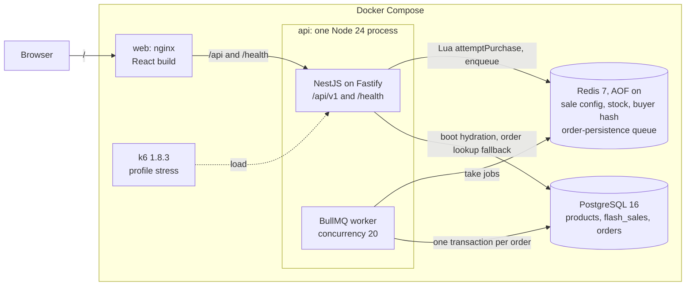
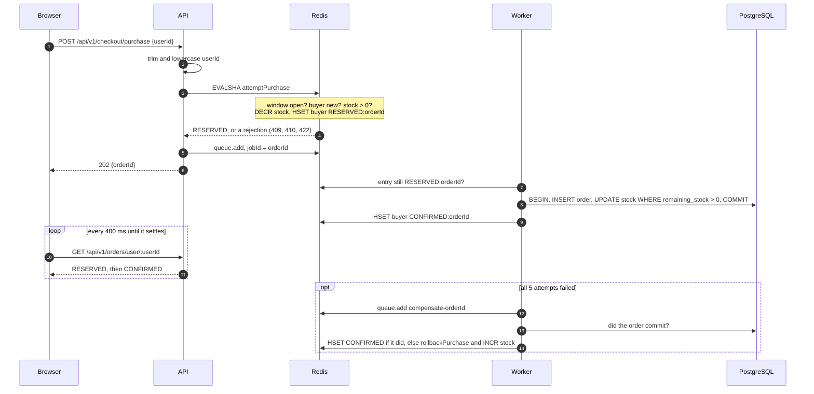
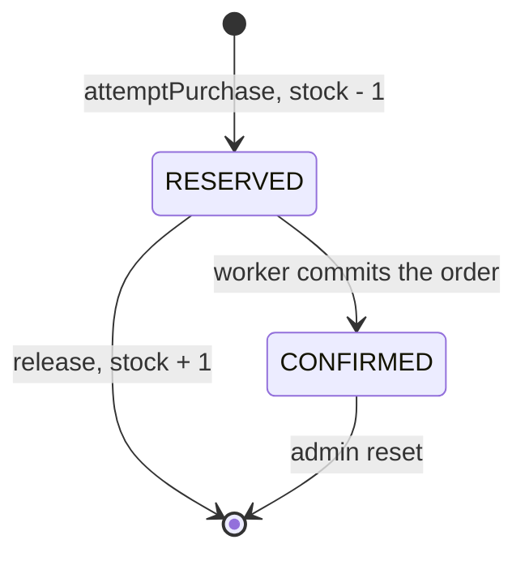
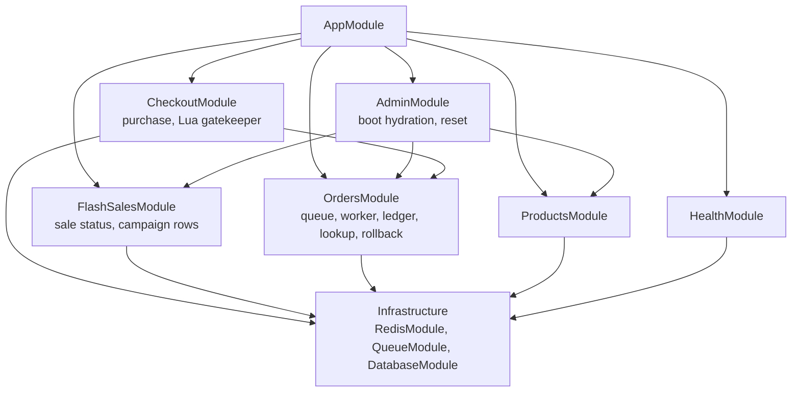

# Flash sale system

A flash sale that sells one limited product to many buyers at once. Each buyer gets at most one unit, and the sale never sells more units than it has. The API is NestJS 11 on Fastify. Redis decides who gets a unit, PostgreSQL stores the orders, and a BullMQ queue moves each reservation from one to the other. The storefront is React 19 with Tailwind CSS 4, served by nginx.

Status: all six phases are built. The API covers the purchase path, order lookup, and admin reset. The React storefront drives every endpoint from the browser. The stress suite and the Docker stack run, with measured results in [Benchmarks](#benchmarks).

## Quick start

You need Docker with Compose v2.

```sh
cp .env.example .env
docker compose up -d --build --wait   # postgres, redis, api, web
curl localhost:3000/health            # {"status":"ok","checks":{"database":"up","redis":"up"}}
open http://localhost:8080            # the storefront
```

The API creates its tables on boot and seeds one product and a sale that is open for 24 hours with 100 units. The "Demo scenarios" toolbar at the bottom of the page resets the sale into other states. If host port 3000 is taken, prefix every `docker compose up` with `PORT=3001`. To work on the code without Docker for the API, see [Run it for development](#run-it-for-development).

## Architecture



One Node process serves HTTP and runs the queue worker. Redis holds the live sale: a config hash with the window and product, a stock counter, and a hash that maps each buyer to `RESERVED:<orderId>` or `CONFIRMED:<orderId>`. The BullMQ queue lives in the same Redis. PostgreSQL is the source of truth for orders and stock. nginx serves the web build and proxies `/api` and `/health`, so the browser calls relative paths and the API needs no CORS.

Each guarantee has a fast check in Redis and a final check in PostgreSQL.

| Guarantee | Redis | PostgreSQL |
| --- | --- | --- |
| No oversell | The Lua script decrements stock only while it is above 0. Redis runs one script at a time. | `UPDATE ... SET remaining_stock = remaining_stock - 1 WHERE remaining_stock > 0` in the order transaction |
| One unit per buyer | The Lua script rejects a buyer who already has an entry. User ids are trimmed and lowercased first. | Unique key on `(flash_sale_id, user_id)` |
| Every 202 ends as an order or a released unit | The worker writes only while the entry still holds its order id. | A compensation job asks PostgreSQL whether the order committed, then confirms or releases. The boot reconciler does the same for reservations with no job left. |

## How a purchase works



One Lua script makes the whole decision inside Redis. It checks the sale window, then whether the buyer already holds a unit, then the stock. A reservation decrements the stock and records `RESERVED:<orderId>` for the buyer in the same step. Because Redis runs one script at a time, two buyers can never take the last unit together, and two requests from one buyer cannot both pass the duplicate check.

The HTTP request ends after the enqueue, so a buyer waits for Redis only, not for PostgreSQL. The worker retries 5 times with exponential backoff that starts at 300 ms. When the last attempt fails, a compensation job with 8 attempts of its own asks PostgreSQL first. An order that did commit is marked CONFIRMED. Otherwise the rollback script returns the unit to the stock, and only while the entry still equals `RESERVED:<orderId>`, so a repeat or late rollback changes nothing.

A buyer's entry moves through these states:



A release happens when the enqueue fails and the job does not exist, when compensation finds no order in PostgreSQL, when the boot reconciler finds a reservation with no job left, or when an admin reset wipes the sale. The order lookup reads the Redis entry first and falls back to PostgreSQL when Redis has none.

On boot, before the HTTP listener opens, the API does two things. When the Redis keys for the sale are missing, it rebuilds them from PostgreSQL, with remaining stock equal to total stock minus confirmed orders. Then it compensates every `RESERVED` entry whose persistence and compensation jobs are both gone or failed.

## Module design

### The API modules form a DAG



An arrow points from a module to a module it imports. Each domain module lives in `apps/api/src/modules/<domain>/` and exports only the services other modules need.

The graph has no cycles, and the code has no `forwardRef()`. Two placements keep it that way:

- **Rollback lives in orders.** Checkout reserves a unit and hands it to orders. Releasing a unit after a failed enqueue or a failed persist also belongs to orders, so orders never imports checkout.
- **Admin sits on top.** Boot hydration and reset need products, the sale, and the orders ledger. Admin imports all three, and none of them imports admin.

Inside a module, each layer has one job, and the build fails when a layer reaches past it.

| Layer | Owns | Must not |
| --- | --- | --- |
| `controllers/` | Routes, DTO binding, mapping an outcome to a status code | Branch on business rules, or inject a repository, `DataSource`, Redis or a queue |
| `services/` | Orchestration over repositories, sibling services and queues | Run SQL, a query builder or a raw Redis command |
| `repositories/` | SQL, transactions, Redis commands, Lua calls | Leak a storage format. Callers get `{ status, orderId }`, never `"RESERVED:<id>"` |
| `processors/` | Turning a BullMQ job into a service call | Hold logic of their own |
| `constants/`, `interfaces/`, `dto/` | Every TTL, key builder, error code, domain type and wire contract | |

### Design decisions

- **Rejections are values.** `CheckoutService.attemptPurchase` returns a discriminated union for the five business outcomes and throws only for infrastructure faults. Sold out and duplicate are the common case under load, and an exception would capture a stack trace for each one. The controller maps each outcome to a status through an exhaustive table, so a new outcome without a status fails the build.
- **A normalized user id is its own type.** `NormalizedUserId` is a branded string. Only the normalizer and the order repository's row mapper create one, so a raw id cannot reach a service or repository without a compile error.
- **Each Redis wire format has one owner.** Only the Lua scripts and `order-cache.repository.ts` know about `RESERVED:<orderId>` and `CONFIRMED:<orderId>`. The sale config hash is written by orders and read by flash sales, so both go through one codec, `infrastructure/redis/flash-sale-config.codec.ts`, with a round-trip test. A missing or non-numeric field, stock included, throws instead of reading as 0.
- **The order id is the job id.** BullMQ refuses custom job ids that contain `:`, so `saleId:userId` cannot work. The order id is unique per reservation, so the same buyer can buy again after a reset without colliding with an old job.
- **Time comes from `ClockService`.** Only `ClockService` calls `Date.now()`. The checkout service passes its time into the Lua script, so a test can run the real script at `startsAt - 1`, `startsAt`, `endsAt` and `endsAt + 1` and expect `SALE_UPCOMING`, `RESERVED`, `RESERVED`, `SALE_ENDED`.
- **Shutdown closes in order.** The worker and queue close in `onModuleDestroy`, and Redis quits later in `onApplicationShutdown`, so a job in flight never meets a closed connection.

### The web modules

`apps/web/src/modules/` has five feature modules: `product`, `flash-sale`, `checkout`, `orders` and `simulation`. Each has `api/`, `hooks/`, `components/`, `types/`, `constants/`, `__tests__/` and an `index.ts` barrel. A module imports another only through its barrel, and the checker fails any deeper import. Checkout imports the confirmation poller from orders, the same direction as the API's checkout to orders edge.

The browser treats rejections as values too. The HTTP client never throws. It returns `{ ok: true, data }` or `{ ok: false, status, error }`, and a network failure becomes status 0 with `NETWORK_ERROR`. Hooks hold their state in discriminated unions such as `idle | loading | success | error`, so a component cannot render a receipt and an error at once. Components start no timers and make no requests. `usePolling` runs a task, waits for it, then schedules the next run, so a slow response never overlaps the next request.

## HTTP API

All routes except `/health` live under `/api/v1`.

| Method | Path | Result |
| --- | --- | --- |
| `GET` | `/health` | 200 when PostgreSQL and Redis answer, 503 otherwise |
| `GET` | `/api/v1/products/featured` | The product on sale |
| `GET` | `/api/v1/flash-sales/current` | Sale state (`UPCOMING`, `ACTIVE`, `SOLD_OUT`, `ENDED`), stock, window and `serverTime`. Cached for 200 ms |
| `POST` | `/api/v1/checkout/purchase` | Body `{ "userId": "..." }`. Outcomes below |
| `GET` | `/api/v1/orders/user/:userId` | `NONE`, `RESERVED` or `CONFIRMED`, with the `orderId` |
| `POST` | `/api/v1/admin/flash-sales/reset` | Demo tool. Body `{ totalStock?, startsOffsetSeconds?, durationSeconds?, productName? }`, every field optional. Returns 404 unless `ENABLE_ADMIN_ENDPOINTS=true` |

| Purchase outcome | Status | `code` |
| --- | --- | --- |
| Unit reserved | 202 | `RESERVED` |
| Buyer already holds a unit | 409 | `ALREADY_PURCHASED` |
| No stock left | 410 | `SOLD_OUT` |
| Sale not started, or over | 422 | `SALE_UPCOMING`, `SALE_ENDED` |
| User id is not 3 to 128 characters of `a-z 0-9 . _ @ + -` after trimming and lowercasing | 400 | `INVALID_USER_ID` |
| Redis or the queue failed | 503 | `TEMPORARY_FAILURE` |

`" Alice@Example.com "` and `alice@example.com` are the same buyer.

## The storefront

The page at `/` has a card for each of four modules and a toolbar for the fifth. The product card shows the SKU, the flash price, the struck-through original price and "Limit 1 Per Customer". The `Sale status` card shows a state pill, a countdown and a stock bar. The `Checkout` card has a user id field, a "Random Test User" button and "Buy Now", with a banner for each outcome. The `Order lookup` card finds any buyer's order.

The status card polls `GET /api/v1/flash-sales/current` every 2 seconds. The countdown does not trust the browser clock. It counts from the response's `serverTime` plus the time elapsed since, so a laptop clock that is hours off still shows the right seconds.

"Buy Now" is locked while the sale is not `ACTIVE`, while a request is in flight, and while the user id is blank. After a 202 the checkout card polls the order every 400 ms. `CONFIRMED` shows a receipt with the order id, and `NONE` means the reservation was released. After 75 polls, about 30 seconds, the card says the order is still confirming and points to the lookup card.

The "Demo scenarios" toolbar resets the sale through the admin endpoint with four presets: an active sale with 100 units for an hour, high scarcity with 3 units, a sale that starts in 15 seconds, and one that ended an hour ago. The reset response goes straight into the status card, and the checkout and lookup cards remount, which drops stale banners and pollers.

## Testing strategy

### Test levels

Work follows red, green, refactor, as AGENTS.md requires. A slice starts with the smallest contract that compiles, then a spec that fails for the expected assertion, then the code that makes it pass.

| Level | Location | Runs against | Files | Tests |
| --- | --- | --- | --- | --- |
| API unit | `apps/api/test/unit/` | One class, collaborators mocked, clock pinned | 33 | 244 |
| API integration | `apps/api/test/integration/*.spec.ts` | Real PostgreSQL 16, Redis 7 and BullMQ | 20 | 115 |
| API end to end | `apps/api/test/integration/*.e2e-spec.ts` | The whole app over HTTP, real stores | 3 | 18 |
| Web | `apps/web/src/**/__tests__/` | Vitest and React Testing Library, only `fetch` stubbed | 16 | 150 |
| Checker | `scripts/*.test.mjs` | `node --test` against fixture sources | 3 | 42 |
| Stress | `tests/stress/` | The running Docker stack | 2 scenarios | |

The unit specs mock collaborators and pin time through `ClockService`. The integration specs prove what mocks cannot: the sale window at its four boundaries, the Lua scripts under 100 parallel calls, the unique key and stock guard in PostgreSQL, the fence that turns a released reservation's job into a no-op, the boot reconciler against real job states, and the shutdown order. `shutdown-order.redis.spec.ts` fails if Redis closes before the worker. The end-to-end race suite fires 100 buyers at 10 units and 50 requests from one buyer, then checks the database. The web specs run the real HTTP client, hooks and components, and move Vitest's fake timers instead of sleeping.

Tests were checked against deliberate bugs. Forcing the reconciler's pending-job check to `false` fails 9 of the 19 reconciler tests. A reconciler that does nothing fails all 4 reconciliation integration tests. In the stress suite, a stray order row or one extra unit in Redis fails the store checks, as [Benchmarks](#benchmarks) describes.

### Biome and the AST checker

Biome 2.6.8 is the only linter and formatter, with no ESLint or Prettier. `pnpm lint` runs `biome check --error-on-warnings`, so a warning fails the build. On top of the `recommended` preset these rules are errors:

| Rule | Why |
| --- | --- |
| `noExplicitAny` | The repo has no `any` in `src/` or `test/` |
| `noConsole` | The API logs through Nest's logger. Only `tests/stress/` and `scripts/` may print |
| `noExcessiveCognitiveComplexity`, max 10 | Forces guard clauses and small functions |
| `noUselessElse` | Early returns instead of `else` chains |
| `useImportType`, web only | Type-only imports vanish from the bundle. The API keeps it off because Nest's DI reads constructor types at runtime |

TypeScript 6 runs with `strict`, `noImplicitAny`, `strictNullChecks`, `noUnusedLocals` and `noUnusedParameters`.

Biome cannot express the architecture rules, so `scripts/verify-agent-limits.mjs` walks every source file with the TypeScript compiler API. It runs as the second half of `pnpm lint`.

| Rule | Fails when |
| --- | --- |
| `max-file-lines` | A source file passes 220 lines, or a spec passes 250 |
| `max-function-lines` | A function passes 40 lines |
| `max-params` | A function takes more than 3 positional parameters. Nest constructor injection is exempt |
| `controller-injection` | A controller injects a repository, `DataSource`, the Redis client or a queue |
| `service-raw-storage` | A service or processor calls a Redis command, a Lua script, SQL or a query builder, or injects `REDIS_CLIENT` |
| `no-forward-ref` | Any file calls `forwardRef` |
| `module-barrel-import` | A web module imports another module's internals instead of its `index.ts` |

An exception needs a `// agent-limits-allow <rule>: <reason>` comment, and a marker without a reason fails too. The repo has no exceptions. The checker has its own 42 tests, and a planted `REDIS_CLIENT` injection in a service fails it.

### The gate

`pnpm verify` runs every check in order and prints one PASS or FAIL line per step:

1. The `postgres` and `redis` containers are healthy.
2. `pnpm lint`, which is Biome plus the AST checker over the whole repo.
3. `pnpm test:scripts`, the checker's own tests.
4. `pnpm -r typecheck`.
5. The compose `api` container is stopped.
6. Every API Jest suite under `--detectOpenHandles`, without `--forceExit`, inside a 300-second timeout. Any open handle fails the step.
7. The web Vitest suite.
8. `pnpm -r build`.

Step 5 exists because the integration suites share the compose PostgreSQL, Redis and queue name. A running API container's worker takes the suites' jobs and fails them. Run `docker compose stop api web` before `pnpm verify` or the integration suites.

## Benchmarks

Both scenarios live in one table, `tests/stress/scenarios.mjs`, which the k6 scripts and the Node runner import. Each run starts with an admin reset.

| Scenario | Stock | Requests | Concurrency | Pass condition |
| --- | --- | --- | --- | --- |
| `oversell` | 100 | 5,000 distinct buyers | 250 | exactly 100 × 202 and 4,900 × 410, no 409, no 5xx, k6 p95 under 250 ms and p99 under 500 ms |
| `same-user-race` | 50 | 300 requests from one buyer in 4 case and whitespace variants | 100 | exactly 1 × 202 and 299 × 409, no 410, no 5xx |

```sh
docker compose up -d --build --wait
pnpm stress:k6:oversell     # k6 in a container on the compose network
pnpm stress:k6:same-user
nvm use                     # pnpm refuses a node older than 24
BASE_URL=http://localhost:3000 pnpm stress:node   # both scenarios, then checks PostgreSQL and Redis
```

The k6 scripts run with `--no-deps`, so they hit the stack you started and never recreate it. A broken threshold exits with code 99.

Before its first purchase, each oversell VU opens its connection with an untimed `GET /health`. The Node runner opens its 250 keep-alive sockets the same way. The budgets then measure purchases, not connection setup, and k6 reports the warm-up wait as `connection_warmup`. The race scenario fires cold on purpose, so its 300 requests land together. It has no latency budget.

The Node runner uses only Node built-ins. After a scenario it polls the order lookup until every buyer who got 202 is `CONFIRMED`, which means the queue has persisted every reservation. It then reads PostgreSQL and Redis and checks that:

- the order ids in PostgreSQL equal the order ids from the 202 responses, with none missing and none extra;
- `remaining_stock` equals `total_stock` minus the orders;
- the Redis stock equals the scenario stock minus the reservations;
- the Redis buyer hash holds exactly one `CONFIRMED` entry per reservation;
- Redis stock plus PostgreSQL orders equals the stock;
- in the race, the one order belongs to `stress-racer@example.com`.

It ends with `STRESS OK`, or with `STRESS FAILED: <checks>` and exit code 1.

### Results

All runs are from 2026-11-21 on one 4-core WSL2 machine under Docker Desktop. The load generator shared the CPU with the API, Redis and PostgreSQL. Throughput is purchase attempts per second over the whole run, warm-up included, which is k6's `iterations` rate. For the Node runner it is purchases divided by the timed burst. Latency is for purchase requests. The same-user k6 rows also include the one reset request. The first one or two oversell runs after the API container starts are slower while the JIT warms up, so every series below skips them.

The main series ran on an image built at 11:17. Runs alternated between configurations, and other work on the machine pushed the load average to 4 to 6 during some of them. Each cell is the median, with the range in brackets.

| Run | Throughput | p50 | p95 | p99 | max |
| --- | --- | --- | --- | --- | --- |
| k6 oversell, 9 runs | 2,697 req/s [2,099 to 3,077] | 33 ms [31 to 45] | 57 ms [45 to 71] | 78 ms [49 to 98] | 88 ms [63 to 156] |
| k6 same-user, 5 runs | 2,087 req/s [1,089 to 2,170] | 14 ms [12 to 31] | 90 ms [85 to 195] | 98 ms [88 to 206] | 98 ms [89 to 208] |
| Node runner oversell, 6 runs | 2,502 req/s [1,611 to 2,938] | 92 ms [77 to 145] | 156 ms [128 to 296] | 214 ms [183 to 354] | 245 ms [202 to 373] |
| k6 oversell without warm-up, 3 runs | 3,189 req/s [3,166 to 3,197] | 49 ms [35 to 67] | 68 ms [48 to 103] | 1.32 s [0.14 to 1.44] | 1.42 s [1.08 to 1.49] |
| k6 oversell through nginx (`BASE_URL=http://web`), 3 runs | 2,045 req/s [2,011 to 2,211] | 104 ms [94 to 105] | 140 ms [133 to 143] | 157 ms [143 to 159] | 206 ms [190 to 315] |

Every run in this table returned its exact status counts. The nginx runs pass every threshold. Before nginx pooled its API connections, two runs through it failed `p(95)<250` at 296 to 340 ms, and the no-warm-up runs failed only `p(99)<500`. The nginx row ran later in the day, interleaved with 3 direct runs that measured 2,383 req/s [1,963 to 2,480], p50 53 ms, p95 73 ms and p99 90 ms, so compare it with those and not with the 9-run direct row. After every run the persistence queue went idle, PostgreSQL and Redis held the same buyer and order id pairs, Redis stock plus PostgreSQL orders equaled the stock, and `remaining_stock` matched the order count. The API wrote no log lines during any run.

A confirmation series ran on the final code, an image built at 11:45 that includes the last refactor, with the load average at 1 to 2. Each cell is the range.

| Run | Throughput | p50 | p95 | p99 | max | Counts |
| --- | --- | --- | --- | --- | --- | --- |
| k6 oversell, 3 runs | 1,943 to 2,799 req/s | 37 to 49 ms | 53 to 75 ms | 58 to 97 ms | 70 to 120 ms | 100 × 202, 4,900 × 410, every threshold passed |
| k6 same-user, 2 runs | 1,647 to 1,790 req/s | 18 to 27 ms | 94 to 131 ms | 111 to 135 ms | 113 to 138 ms | 1 × 202, 299 × 409 |
| Node runner oversell, 2 runs | 2,653 to 2,677 req/s | 91 ms | 125 to 135 ms | 167 to 170 ms | 186 to 213 ms | `STRESS OK`, 27 checks passed |
| Node runner same-user, 2 runs | 2,801 to 2,900 req/s | 31 to 34 ms | 42 to 44 ms | 46 to 49 ms | 49 to 53 ms | `STRESS OK` |

During the three k6 oversell runs, a loop polled `GET /health` every 100 ms. All 292 polls returned 200. The check matters because the PostgreSQL pool has 20 connections, as many as the worker's concurrency. The API logged no warnings or errors.

A 30,000-request run sustained 3,176 req/s. The API's main thread used 0.94 of a core, about 300 µs of CPU per request. Redis used 0.30 of a core and PostgreSQL 0.02. One Node process is the ceiling, so doubling throughput takes a second API process or replica, and Redis has room for it.

How to read these numbers:

- **The opening wave needs a warm-up.** Node 24 ships libuv 1.52, which accepts one pending connection per event-loop iteration, a behavior that starts in libuv 1.46. Node 18's libuv 1.44 accepted all pending connections at once. A test with 50 simultaneous connections showed this on Node 18.17, 24.18 and the API image's 24.22. When 250 VUs connect at once against a busy event loop, the API's accept queue holds about 130 connections and drains one every 10 to 20 ms. Those VUs' first requests wait 0.3 to 3 s, reach Redis after the stock is gone, and return 410. Without the warm-up, this cluster held 17 to 120 requests per run, so p99 jumped between 138 ms and 5.9 s and failed the 500 ms budget in 3 of 4 runs. The kernel counted no listen overflows, drops or retransmits. The wait still shows in `connection_warmup`, with a max of 1.5 to 2.5 s.
- **The Node runner measures its own queueing.** Its p95 is about 2.7 times k6's, because one Node process with 250 requests in flight delays its own responses. Its event-loop delay p99 was 55 to 80 ms. k6 owns the budgets.

Fault injection shows the checks can fail. A stray order row inserted into PostgreSQL mid-run failed the order-id, `remaining_stock` and conservation checks. In another run, one unit added to the Redis stock after the sale sold out made the API reserve 101 units. PostgreSQL refused the 101st order through its `remaining_stock > 0` guard, the compensation job returned the unit, and the runner failed six checks. Editing the k6 table to expect 99 reservations, or setting the budget to 1 ms, failed the matching threshold.

The end-to-end suite and earlier `curl` runs give the same counts at smaller scale:

| Run | Requests | Result |
| --- | --- | --- |
| `flash-sale-race.e2e-spec.ts` | 100 buyers, 10 units | 10 × 202, 90 × 410, 10 orders, `remaining_stock` 0 |
| `flash-sale-race.e2e-spec.ts` | 50 requests from one buyer | 1 × 202, 49 × 409 |
| Live API, 80 parallel `curl` processes | 400 buyers, 10 units | 10 × 202, 390 × 410, Redis stock 0, 10 orders |
| Live API, 80 parallel `curl` processes | 200 requests from one buyer in 4 case and space variants | 1 × 202, 199 × 409, 1 order |

## Trade-offs and known limits

### Choices

- **Redis decides, PostgreSQL records.** A buyer gets 202 after one Lua call and one enqueue, without waiting for a database write. The cost is a window where an order is `RESERVED` but not yet in PostgreSQL, and a pipeline of retries, compensation and boot reconciliation to close that window. Redis runs with AOF, so the queue and the ledger survive a restart. With the default `appendfsync everysec`, a Redis crash can lose about the last second of writes, and PostgreSQL's unique key and stock guard still refuse a duplicate or an extra order.
- **One Lua script instead of locks.** Redis runs a script without interleaving, so the decision needs no `WATCH` retries and no row lock. All purchases go through one Redis primary, which caps the design at one Redis's throughput. PostgreSQL's unique key and stock guard would still hold if Redis were wrong.
- **Polling instead of push.** Sale status can be up to 2 seconds old, plus the 200 ms server cache. When stock runs out, "Buy Now" stays enabled until the next poll, and a click in that gap gets the 410 banner. Server-sent events would close the gap at the cost of a connection per open page.
- **No rate limiting.** The stress scenarios measure concurrency from one host, and a limiter would turn that load into 429s. A public deployment needs one in front of `/checkout/purchase`.
- **nginx pools its connections to the API.** Node 24 accepts one pending connection per event-loop iteration, so under load a proxy that opens a connection per request queues behind the API's own work. `apps/web/nginx.conf` uses a named upstream with `keepalive 64` and HTTP/1.1. Before this change, an oversell run through nginx made the API accept 5,252 connections, doubled its CPU, and failed the p95 budget at about 320 ms. With the pool, the API accepted 6 to 15 connections per run, and p95 through nginx was 133 to 143 ms. `server api:3000 resolve` with Docker's DNS still finds a recreated API, in 3.6 s in the stack and about 4 s when the container came back with a new IP. If nginx starts before `api` resolves, it answers 502 for up to about 8 s after the API appears (`resolver_timeout 5s`). Compose starts web only after the API is healthy.
- **One sale.** The active sale id is a constant.

### Limits

- **One API instance.** Boot hydration is a check and then a write, the boot reconciler assumes no other instance is enqueuing, and the reset lock is in-process. Two API instances could race on each.
- **No periodic sweep.** A reservation can be left with no job when the enqueue and the release both fail, when the process dies between the Lua step and the enqueue, or when a lost Lua reply is resent and answered `ALREADY_PURCHASED`. The boot reconciler releases it, so a unit orphaned while the API runs comes back at the next boot or reset.
- **An unclear enqueue releases the reservation.** When `queue.add` fails, the API looks the job up by its order id and keeps the reservation only if the job exists. Otherwise it releases the reservation and answers 503, and a job stored after all finds its reservation gone and writes nothing. One race is left. If the reply was lost, the lookup failed too, and a worker took the job just before the release, that job still writes its order. Redis then offers one unit more than PostgreSQL holds, so the buyer who takes it gets 202 and is released later.
- **Compensation needs Redis.** The worker queues the compensation job when the last attempt fails. If Redis is unreachable then, nothing can be queued and the API logs an error. The same holds when the compensation job uses up its 8 attempts. The next boot or an admin reset releases the held unit.
- **Reset is a demo tool.** It pauses the queue, waits up to 10 seconds for jobs in flight and answers 503 if they do not finish, discards waiting jobs, rebuilds the sale and resumes the queue. Resets run one at a time per process, and a failed reset does not block the next. A purchase that reserves against the old state while a reset runs gets 202, but its job finds the reservation gone, so that buyer ends with no order. If the process dies mid-reset, PostgreSQL and Redis can disagree until you run the reset again.
- **Admin endpoints are off by default.** The schema default for `ENABLE_ADMIN_ENDPOINTS` is `false`. `.env.example` and docker-compose turn it on for development, the demo toolbar and tests. The switch is the only protection, and `productName` changes only the cached sale, not the stored product.
- **Direct clients without keep-alive still pay the accept queue.** A burst of new connections to the API's published port waits one event-loop iteration per connection while the API is busy. Browsers reach the API through nginx, which pools, and the stress scripts warm their connections first.
- **The countdown can be up to 200 ms off.** A status served from the micro-cache carries the `serverTime` it was computed with.

## Run it for development

You need Node 24 or later and pnpm 12, for the API and the web app alike. `.nvmrc` pins 24, and both Docker images build on `node:24-alpine`. The root `package.json` and both apps declare `engines.node` `>=24.0.0`. The root also sets `devEngines.runtime`, so on an older Node `pnpm install` and every `pnpm run` stop with `ERR_PNPM_BAD_RUNTIME_VERSION`. `engines` alone would not stop them, because the corepack pnpm is a native binary that checks its own built-in runtime. `packageManager` pins pnpm 12.16.1, so `corepack enable` installs it. That pnpm runs scripts with the first `node` on `PATH`, so run `nvm use` in each new shell.

```sh
nvm use
corepack enable
cp .env.example .env               # change POSTGRES_PORT or REDIS_PORT if those ports are taken
docker compose up -d --wait postgres redis
pnpm install
pnpm --filter @flash-sale/api build
pnpm --filter @flash-sale/api start
# in a second shell
pnpm --filter @flash-sale/web dev  # http://localhost:5173, proxies /api and /health to 127.0.0.1:3000
```

Set `VITE_API_PROXY_TARGET=http://127.0.0.1:3001` when the API runs on another port. Compose publishes PostgreSQL and Redis on `127.0.0.1` only.

| Variable | Default in `.env.example` | Meaning |
| --- | --- | --- |
| `PORT` | 3000 | API port |
| `WEB_PORT` | 8080 | nginx port in Docker |
| `POSTGRES_PORT` | 5432 | Host port for PostgreSQL |
| `REDIS_PORT` | 6379 | Host port for Redis |
| `ENABLE_ADMIN_ENDPOINTS` | true | Turns on the reset endpoint. The schema default is false |
| `LOG_LEVEL` | info | Pino log level |

Tests:

```sh
pnpm --filter @flash-sale/api test:unit         # no containers needed
pnpm --filter @flash-sale/api test:integration  # needs postgres and redis, with the api container stopped
pnpm --filter @flash-sale/api test:e2e          # the HTTP end-to-end suites only
pnpm --filter @flash-sale/web test              # no containers needed
pnpm verify                                     # the full gate
```

### The Docker images

The API image is a two-stage build on `node:24-alpine`. The build stage installs pnpm 12.16.1, runs `pnpm install --frozen-lockfile` for the API's workspace slice, compiles, and runs `pnpm deploy --prod` to copy only production dependencies. A BuildKit cache mount keeps the pnpm store between builds, so a rebuild after a dependency change downloads only new packages. The runtime stage holds `dist` and those dependencies, runs as the `node` user, and is 385 MB. Optional dependencies stay in, so the musl build of `msgpackr-extract` is present and BullMQ gets native msgpack on Alpine. The web image builds with Vite on `node:24-alpine` and serves the result from nginx.

Compose starts the API only after PostgreSQL and Redis report healthy, and starts web and k6 only after the API's `/health` passes.

## Repository layout

```text
apps/api/src/
  common/            user id normalizer and pipe, clock, error filter
  config/            environment validation
  infrastructure/    database, redis with the Lua scripts, queue
  modules/
    products/        featured product
    flash-sales/     sale status and campaign rows
    checkout/        purchase endpoint and the Redis gatekeeper
    orders/          persistence queue, worker, lookup, Redis order ledger
    admin/           boot hydration and reset
apps/api/test/
  unit/              one spec per class, collaborators mocked
  integration/       real PostgreSQL and Redis; *.e2e-spec.ts boot the whole app
  support/           shared harnesses and mocks
apps/web/src/
  app/               app shell, layout, error boundary
  shared/            HTTP client, polling hook, Card, Alert, StatusPill, currency format
  modules/           product, flash-sale, checkout, orders, simulation
scripts/             the AST checker and its tests
tests/stress/        scenario table, k6 scripts, zero-dependency Node runner
```

[AGENTS.md](AGENTS.md) holds the engineering rules for test-first development, layering and size limits.
