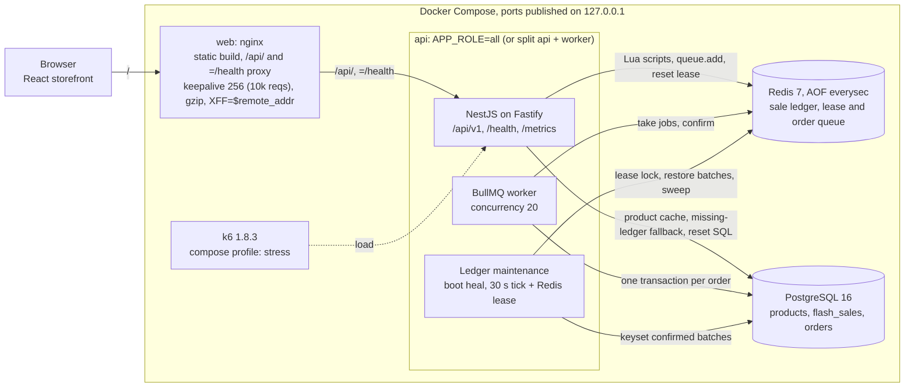
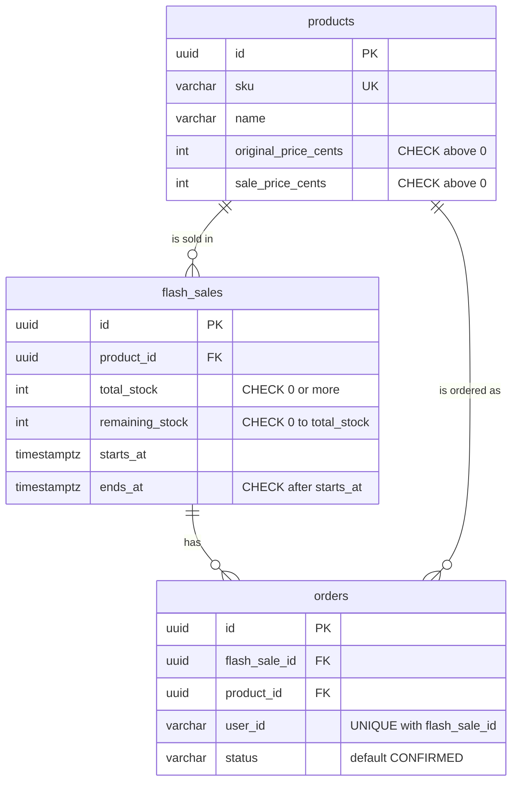
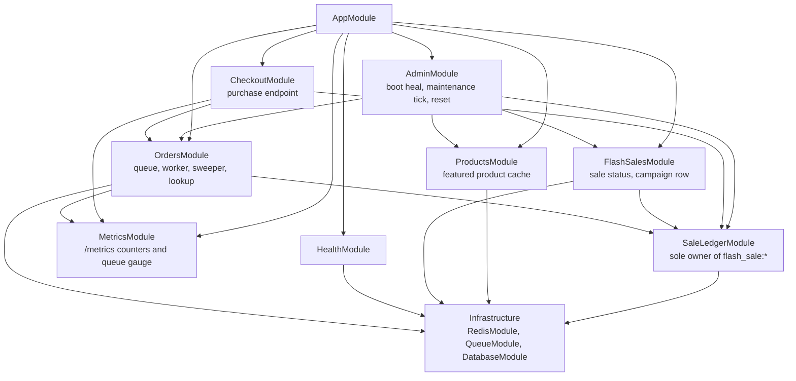
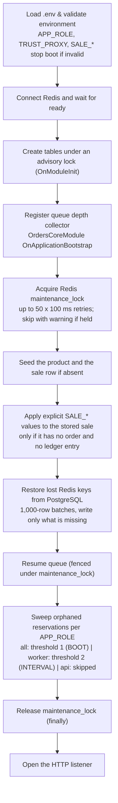
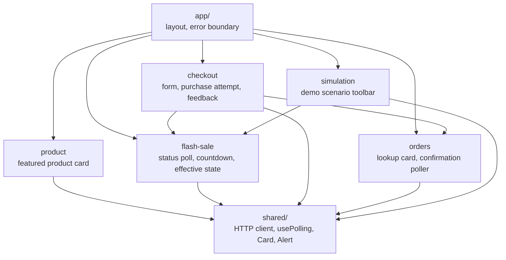

[← README](../README.md)

# Architecture

This page names the components, says which one owns which data, and shows how the code is layered. The request path is in [purchase-flow.md](purchase-flow.md), and what happens when a part fails is in [fault-tolerance.md](fault-tolerance.md).

## System context

| Component | Job | State it owns | When it is down |
| --- | --- | --- | --- |
| nginx | Serves the React build, pools `keepalive 256` (`keepalive_requests 10000`, HTTP/1.1) to `api:3000` with 10 s Docker DNS re-resolution, overwrites `X-Forwarded-For` and `X-Real-IP` with `$remote_addr`, adds gzip, sets security headers (`X-Content-Type-Options`, `X-Frame-Options`, `Referrer-Policy`, `Content-Security-Policy`) on static `location /` responses without duplicating API headers, enforces 5 s connect / 15 s read+send proxy timeouts, and proxies `/api/` and exact `/health` (never `/metrics`) so the browser uses relative URLs and the API needs no CORS | None | The storefront is unreachable. The API still answers on its own port (single-node mode) |
| API (HTTP) | Validates input, enforces optional per-IP `RateLimitGuard` (keyed by `request.ip` under `TRUST_PROXY`, capped at 50,000 buckets with O(1) eviction), `ADMIN_API_KEY`, and `Content-Type: application/json` (`415` on admin reset), runs the purchase gate, answers `200`, `202`, `400`, `401`, `404`, `409`, `410`, `413`, `415`, `422`, `429` or `503`, serves status (`Cache-Control: no-store`, PG-checked `503` vs `404` on `NOT_CONFIGURED`), product (`Cache-Control: public, max-age=60, stale-while-revalidate=300`), lookup (`Cache-Control: no-store`), `/health`, and `/metrics` | 60 s singleflight product micro-cache (+ stale `lastKnownProduct` with 5 s DB retry backoff), 200 ms status snapshot cache (`FOUND` only), optional in-memory rate-limit buckets, per-process metrics counters | Purchases stop. Reservations already made stay in Redis, and their jobs stay queued |
| Worker | Turns a reservation into a PostgreSQL order and confirms it in Redis | None | Jobs wait in the queue. Buyers keep getting 202 until stock runs out |
| Ledger maintenance | At boot (all roles; 50 × 100 ms lease retry, skips with warning if held): hydrates Redis, fences `queue.resume()` under the lease, and sweeps per `APP_ROLE` (`all`: threshold 1, `api`: skipped, `worker`: threshold 2). Every 30 s (`all` or `worker`; 1-shot lease): finishes an in-memory pending reset, restores lost Redis keys in 1,000-row batches from PostgreSQL, fences `queue.resume()`, and releases orphaned reservations (threshold 2) | Orphan strike counts and an in-memory pending reset plan | Self-healing pauses. Nothing breaks until something else fails |
| Redis | Decides who gets a unit, holds the order queue and maintenance lease | Sale config, stock counter, buyer entries, maintenance lock, queue | Every route answers 503 within about 2 s. See [fault-tolerance.md](fault-tolerance.md) |
| PostgreSQL | Durable orders, and the last guard against oversell and duplicates | `products`, `flash_sales`, `orders` | Purchases still answer 202, intact-ledger lookups answer `RESERVED`/`CONFIRMED`/`NONE` from Redis, and warm featured-product caches serve `lastKnownProduct` with a 5 s retry backoff (cold product cache and missing-ledger fallback answer `503`). Orders land when PostgreSQL returns |

By default (`APP_ROLE=all`), the API and the worker share one Node process. Setting `APP_ROLE=api` and `APP_ROLE=worker` (configured in `docker-compose.scaled.yml`) splits HTTP replicas from the background worker and maintenance loop; see [scaling.md](scaling.md).

## Who owns which data

The central rule is that **Redis decides and PostgreSQL records**. A purchase answers after one Lua call and one enqueue, and never waits for a database write.

| Data | Authoritative store | Why |
| --- | --- | --- |
| Who holds a unit right now, and units left | Redis | One script decides, and Redis runs one script at a time |
| Confirmed orders | PostgreSQL | Durable, constrained, queryable |
| `remaining_stock` | PostgreSQL | The transaction that inserts an order also decrements it, so it equals `total_stock` minus the orders |
| Sale window and total stock | PostgreSQL (`flash_sales`), copied to Redis | The script reads the window from Redis, so a purchase touches one store |
| Order queue | Redis (BullMQ) | The enqueue is one more command on a connection that is already open |

Redis can lose data. A crash with `appendfsync everysec` loses up to about a second of writes, and `FLUSHALL` loses everything. So PostgreSQL carries its own guards, and the system rebuilds Redis from PostgreSQL. Each guarantee has a fast check and a final check.

| Guarantee | Fast check (Redis) | Final check (PostgreSQL) |
| --- | --- | --- |
| No oversell | The script decrements stock only while it is above 0 | `UPDATE flash_sales SET remaining_stock = remaining_stock - 1 WHERE remaining_stock > 0` inside the order transaction. Zero updated rows rolls the order back |
| One unit per buyer | The script rejects a buyer who already has an entry. Ids are trimmed and lowercased first | `UNIQUE (flash_sale_id, user_id)` on `orders` |
| Every 202 ends as an order or a released unit | Every write after the reservation is fenced by the order id in the entry | A compensation job asks PostgreSQL whether the order committed, then confirms or releases. A 30 s sweep does the same for reservations with no job |

## Redis keys and scripts

One module, `modules/sale-ledger`, owns every key and every script (`SaleLedgerRepository` and `SaleLedgerLeaseRepository`). Nothing else knows a key name or a value format. All four sale keys embed `{saleId}` as a Redis Cluster hash tag so multi-key Lua scripts and `MULTI` pipelines target one hash slot.

| Key | Type | Content |
| --- | --- | --- |
| `flash_sale:{saleId}:config` | hash | `saleId`, `totalStock`, `startTimeMs`, `endTimeMs` |
| `flash_sale:{saleId}:stock` | string | Units left, an integer |
| `flash_sale:{saleId}:users` | hash | `userId` to `RESERVED:<orderId>` or `CONFIRMED:<orderId>` |
| `flash_sale:{saleId}:maintenance_lock` | string | UUID lease token (`PX 25000 NX`) held during boot hydration, maintenance ticks, and admin resets |
| `bull:order-persistence:*` | BullMQ | Persistence and compensation jobs |

Every entry in the `users` hash holds exactly one unit, `RESERVED` or `CONFIRMED`. So `stock = totalStock - HLEN(users)` always holds, and the restore script relies on it.

| Script | What it does | Called by |
| --- | --- | --- |
| `attemptPurchase` | The purchase gate: resend, window, duplicate, stock, then `DECR` and `HSET RESERVED` | Checkout, for every purchase |
| `confirmPurchase` | Writes `CONFIRMED:<id>` only while the entry is `RESERVED:<orderId>` (or already that `CONFIRMED` value) | The worker after the commit, and compensation |
| `rollbackPurchase` | Deletes the entry and returns the unit, only while the entry is `RESERVED:<orderId>`. A missing stock key stays missing | Compensation, and the enqueue-failure path |
| `adoptOrder` | When PostgreSQL holds an order whose Redis entry is gone, writes `CONFIRMED` and takes one unit as long as the stock key exists (even when `stock <= 0`, clamping displayed `remainingStock >= 0` in the codec) and the entry is absent | `confirmCommitted`, when `confirmPurchase` finds nothing to confirm |
| `restoreConfirmedBatch` | Writes a batch (up to 1,000) of `CONFIRMED` entries with `HSETNX` without overwriting existing entries | Boot and the maintenance tick, via keyset pagination |
| `restoreSale` | Writes only what is missing: the config hash, any trailing `CONFIRMED` entries (`HSETNX`), and the stock key as `totalStock - HLEN(users)` | Boot, and the maintenance tick |
| `releaseLock` | Deletes `maintenance_lock` only if its value equals the caller's `ownerToken` | Boot, maintenance tick, and admin reset `finally` cleanup |

The scripts are registered once on the Redis client. A spec resends every registered script and requires the same state and the declared resend replies (3 repeat the same reply; 4 idempotent mutations return no-op `0`), so a script that is not safe to repeat fails the build.

## PostgreSQL schema

The API creates the tables on boot with `CREATE TABLE IF NOT EXISTS`, inside a transaction that holds a PostgreSQL advisory lock. There is no migration tool, because the schema has three tables and one version.

The two `CHECK` constraints on `flash_sales` mean a bug cannot push stock below zero or above the total. The unique key on `(flash_sale_id, user_id)` means a second order for one buyer cannot commit. Two indexes (`idx_orders_sale_status_created` on `orders (flash_sale_id, status, created_at, id)` and `idx_flash_sales_product_id` on `flash_sales (product_id)`) support keyset-paginated hydration batches (`LIMIT 1000`) and product-to-sale joins.

## Backend modules

The API is NestJS 11 on Fastify (`loadDotEnvFiles()` runs before `parseAppRole`/`parseTrustProxy`; `AppModule.forRole(APP_ROLE)` splits `ProductsCoreModule`, `FlashSalesCoreModule`, and `OrdersCoreModule` so `worker` mounts zero business controllers and `api` registers no `BullModule` consumer queue/processor, keeps `HealthModule` and `MetricsModule` on all roles, keeps `LedgerMaintenanceService` for boot hydration on `api` while disabling ticks and boot sweeps, and runs the BullMQ worker + scheduled maintenance on `all` and `worker`). Each domain module lives in `apps/api/src/modules/<domain>/`.

An arrow points from a module to a module it imports. The graph has no cycle and the code has no `forwardRef()`. Four placements keep it that way.

- **`sale-ledger` is a leaf.** It depends only on the Redis connection. Checkout, orders, flash sales and admin all import its `index.ts`, so none of them needs another to reach the ledger. It exports `SaleLedgerRepository`, `SaleLedgerLeaseRepository`, and types.
- **Metrics is a leaf.** `MetricsModule` exports `MetricsService` without importing business modules; `CheckoutModule` pushes attempt counts and `OrdersCoreModule` pushes persistence counts and registers a queue-depth collector.
- **Orders owns rollback and compensation.** Checkout reserves a unit and hands it to orders. Releasing a unit after a failed enqueue or a failed persist also belongs to orders, so orders never imports checkout.
- **Admin sits on top.** Boot heal, the maintenance tick and reset need products, the sale, the orders pipeline and the ledger. Admin imports all four, and nothing imports admin.

### Layers inside a module

| Layer | Owns | Must not |
| --- | --- | --- |
| `controllers/` | Routes, DTO binding, mapping an outcome to a status code | Branch on business rules, or inject a repository, `DataSource`, Redis or a queue |
| `services/` | Orchestration over repositories, sibling services and queues | Run SQL, a query builder or a raw Redis command |
| `repositories/` | SQL, transactions, Redis commands, Lua calls | Leak a storage format. Callers get `{ status, orderId }`, never `"RESERVED:<id>"` |
| `processors/` | Turning a BullMQ job into a service call | Hold logic of their own |
| `constants/`, `interfaces/`, `dto/` | TTLs, key builders, error codes, domain types, wire contracts | |

`pnpm lint` enforces these rules, and [testing.md](testing.md#static-checks) lists them.

### Infrastructure clients

The process holds three Redis connections with different failure behavior. This matters under load.

| Connection | Used by | While Redis is away |
| --- | --- | --- |
| Hot path (`REDIS_CLIENT`) | Every ledger command: purchase gate, status, order lookup | Offline queue off, 2 s command timeout, one retry per request, reconnect every 50 ms growing to 2 s. Commands reject at once, so the API answers 503 and does not buffer requests in memory. Auto-pipelining batches concurrent commands into one socket write |
| Queue producer | `queue.add` on each purchase | The same fail-fast options, without auto-pipelining |
| Queue worker | The BullMQ worker and its blocking client | ioredis defaults. A blocking read outlasts any command timeout, and the worker should wait out a reconnect and not fail |

The hot-path client waits for `ready` before the app starts. PostgreSQL uses `DATABASE_POOL_MAX` connections when set (`1–200`), otherwise defaulting to `5` for `APP_ROLE=api` and `20` for `all` or `worker`, with a 2 s connect timeout and a 5 s statement timeout.

A Redis or PostgreSQL error that is not an `HttpException` goes through one place, the global exception filter (`GlobalExceptionFilter`). If it matches an unreachable Redis (a timeout, a closed stream, `ECONNREFUSED`) or an unavailable PostgreSQL (`isDatabaseUnavailable`: SQLSTATE `08*`/`57P*`/`53300`, socket faults, pool or statement timeouts), the filter answers `503 TEMPORARY_FAILURE` and logs a warning. Anything else (including corrupt Lua script reply assertions and JS `TypeError`/`RangeError` bugs rethrown by `CheckoutService`) is a `500 INTERNAL_ERROR` with a stack in the log. `app.setup.ts` also attaches `X-Content-Type-Options: nosniff`, `X-Frame-Options: DENY`, and `Referrer-Policy: no-referrer` on all API responses.

### Boot and shutdown

All of this runs before the listener opens, so `/health` turning green also means the heal finished.

Shutdown runs the other way, and a spec fails if it does not. The maintenance timer stops and waits for a tick in progress. The worker closes and finishes its jobs. The queues close. Only then does Redis quit. A job in flight never meets a closed connection.

## Frontend

`apps/web` is React 19 with Tailwind CSS 4, built by Vite and served by nginx. It has five feature modules and a `shared/` folder.

A module imports another only through its `index.ts`. Checkout imports the confirmation poller from orders, the same direction as the API's checkout to orders edge.

How the browser stays correct without a socket:

- **Rejections are values.** The HTTP client never throws, guards empty/non-JSON `2xx` replies with `INVALID_RESPONSE`, and returns `{ ok: true, data }` or `{ ok: false, status, error }` (network failures become status 0 `NETWORK_ERROR`).
- **State is modeled explicitly as discriminated unions.** Request hooks hold `idle | loading | success | error`, the confirmation poller (1,000 ms × 30 attempts, keyed on `[userId, orderId]` so same-user retries after release/timeout start a fresh watch session) holds `idle | polling | confirmed | released | timed-out`, the scenario drawer (showing `AdminKeyField` on `401` and resending `x-admin-key`) holds `idle | applying | applied | failed`, and the status hook tracks `{ sale, error }`.
- **Polling never overlaps.** `usePolling` runs a task, waits for it, then schedules the next run, so a slow response cannot stack requests.
- **Components start nothing.** They hold no timer and make no request. Hooks do.
- **The countdown trusts the server clock.** It counts from the response's `serverTime` plus the time elapsed since, so a laptop clock that is hours off still shows the right seconds. `useEffectiveSaleState` schedules one boundary `setTimeout` (clamped for 32-bit timer safety) rather than a 250 ms polling interval, eliminating idle re-renders while flipping `UPCOMING` -> `ACTIVE` -> `ENDED` on the exact boundary. The server stays the judge, and a click a moment early gets `SALE_UPCOMING`.
- **Stale snapshots lose.** The status hook drops a snapshot whose `serverTime` is older than the one it holds, so a slow poll cannot undo a reset.
- **A result stays visible while the next purchase is pending.** The banner keeps the previous outcome until the new answer arrives, so the card does not flash empty.

## Vocabulary

| Term | Meaning |
| --- | --- |
| Reservation | A `RESERVED:<orderId>` entry plus one unit taken from stock. Created by `attemptPurchase` |
| Ledger | The Redis state of one sale: config, stock and buyer entries |
| Fence | Writing only while the entry still holds the expected order id, as a compare-and-set in Lua |
| Orphan | A `RESERVED` entry with no persistence or compensation job left to run |
| Compensation | Asking PostgreSQL whether the order exists, then confirming or releasing the reservation |
| Restore | Rebuilding lost Redis keys from PostgreSQL, writing only what is missing |
