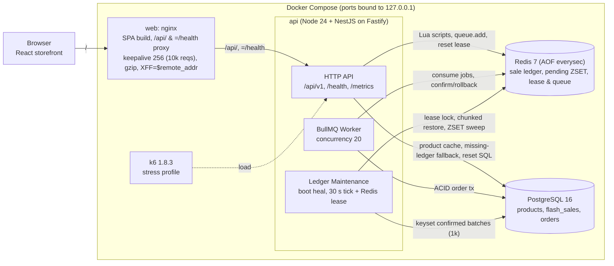
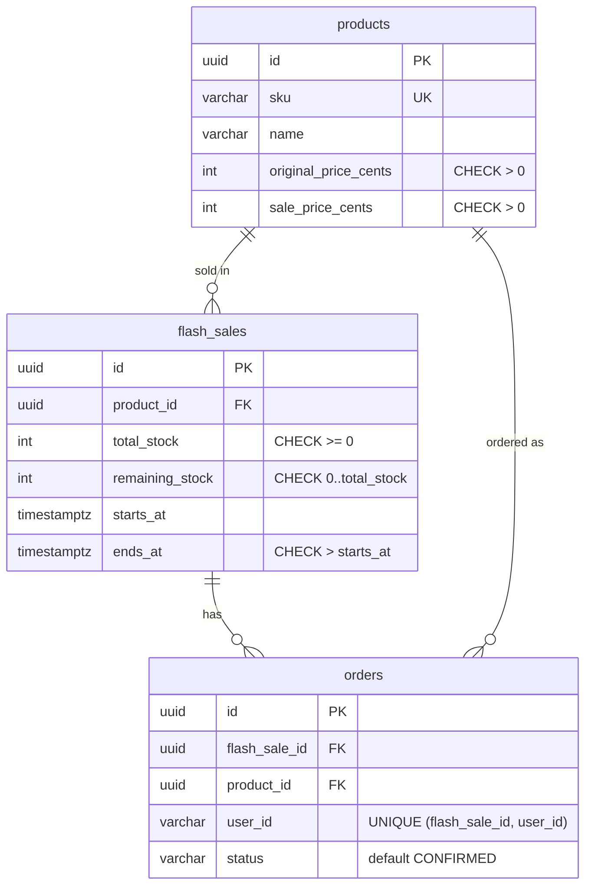
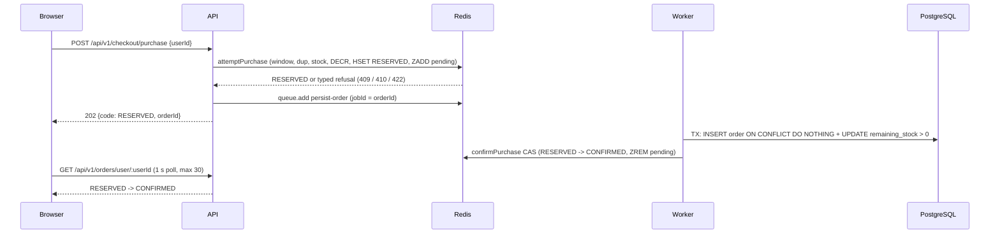
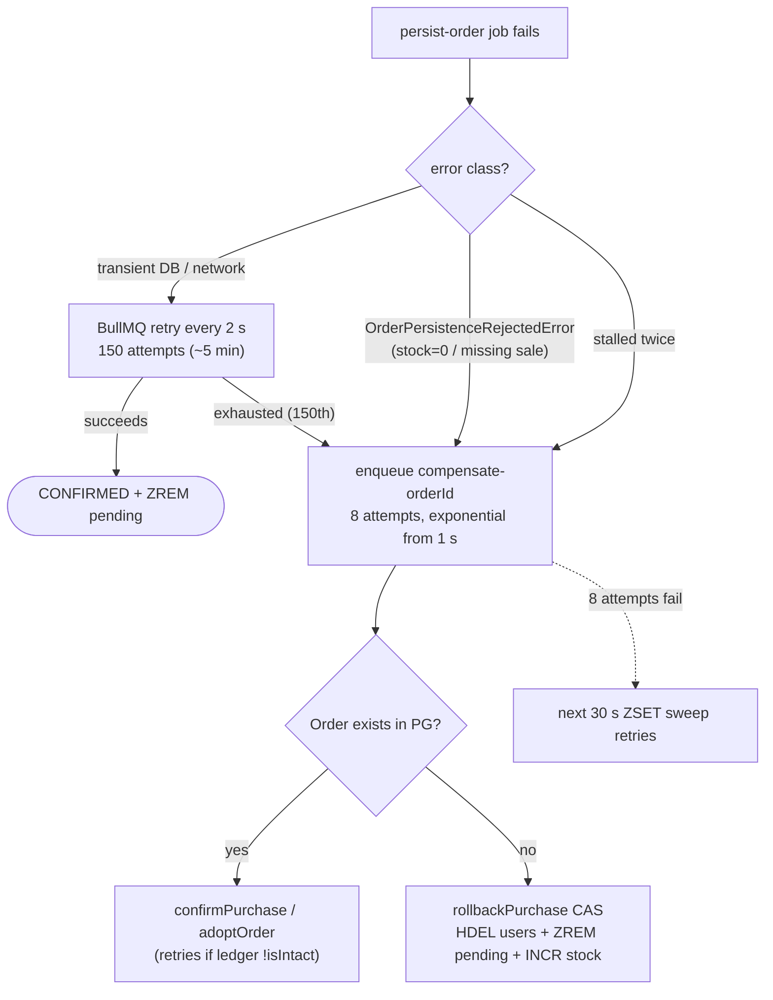
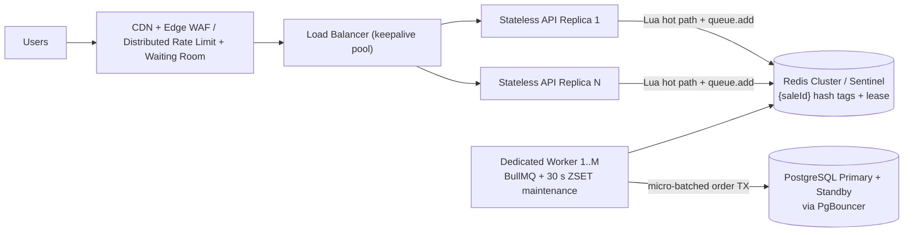
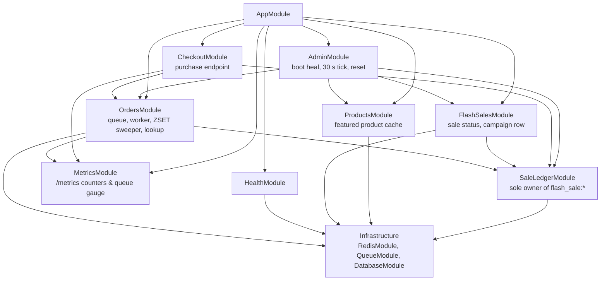

[← README](../README.md)

# Architecture, Fault Tolerance, and Scaling

This document covers the system architecture, data ownership, Redis ledger scripts, end-to-end purchase lifecycle, fault-tolerance guarantees, key design trade-offs, and how the design scales to 10x-100x production load.

## 1. System Context and Components

| Component | Responsibility | State Owned | Failure Impact |
| --- | --- | --- | --- |
| **nginx (`web`)** | Serves React static build; proxies `/api/` and `=/health` (never `/metrics`) over `keepalive 256` (`keepalive_requests 10000`, HTTP/1.1) with 10 s DNS re-resolution; overwrites `X-Forwarded-For` / `X-Real-IP` with `$remote_addr`; emits CSP + security headers on static `location /` without duplicating API headers | None | Storefront unreachable; API still serves directly on `:3000` |
| **API (HTTP)** | Input validation, optional per-IP `RateLimitGuard` (`TRUST_PROXY`), `ADMIN_API_KEY`, `Content-Type: application/json` (`415` on admin reset), atomic purchase gate, status/product/lookup routes, `/health`, `/metrics` | 60 s singleflight product cache (+ stale fallback with 5 s DB retry backoff), 200 ms `FOUND`-only status snapshot cache, optional in-memory rate-limit buckets, Prometheus counters | New purchases stop; existing Redis reservations & BullMQ jobs persist |
| **BullMQ Worker** | Persists each `RESERVED` unit into PostgreSQL in one ACID transaction and confirms or adopts the Redis slot | None | Jobs accumulate in Redis; buyers still get `202` until stock hits `0` |
| **Ledger Maintenance** | On boot (up to `50 × 100 ms` lease retry) and every 30 s (1-shot lease): restores missing Redis keys in 1,000-row batches from PostgreSQL, resumes paused queue under lease, and compensates expired orphan reservations via Redis `ZSET` | Stateless (`activeRun` promise for graceful shutdown only) | Self-healing pauses; steady-state requests are unaffected |
| **Redis 7 (AOF)** | Fast decision engine, pending-reservation index, distributed maintenance lease, BullMQ broker | Sale config, stock counter, buyer hash, pending ZSET, maintenance lock, job queues | API fails fast (`503 TEMPORARY_FAILURE`) within ~2 s; AOF replays on restart |
| **PostgreSQL 16** | System of record for durable orders and final concurrency/stock guards | `products`, `flash_sales`, `orders` | Purchases still answer `202`, intact-ledger lookups answer from Redis, warm product cache serves stale copy; orders persist once PG recovers |

## 2. Data Ownership and Two-Layer Invariants

The core principle is **Redis decides, PostgreSQL records**. Under a flash sale, most requests are refusals (`410 SOLD_OUT`, `409 ALREADY_PURCHASED`). Answering on Redis after a single Lua script + BullMQ enqueue keeps hot-path latency independent of database row locks.

Because Redis (`appendfsync everysec`) can lose up to ~1 s of writes on a sudden crash or flush, every invariant has both a fast Redis check and a final PostgreSQL constraint:

| Invariant | Fast Check (Redis) | Final Check (PostgreSQL) |
| --- | --- | --- |
| **No overselling** | `attemptPurchase` Lua decrements `stock` only when `stock > 0` | `UPDATE flash_sales SET remaining_stock = remaining_stock - 1 WHERE remaining_stock > 0` inside the order TX; `CHECK (remaining_stock >= 0 AND remaining_stock <= total_stock)` |
| **One item per buyer** | Normalized `userId` (`a-z0-9._@+-`, 3–128 chars) rejected if already in `:users` | `UNIQUE (flash_sale_id, user_id)` on `orders` |
| **Every `202` resolves** | Entry stores `RESERVED:<orderId>` and `:pending` ZSET records `(nowMs, userId)`; all later mutations CAS on `orderId` | Worker retries 5 min; compensation queries PostgreSQL before releasing; 30 s ZSET sweep compensates jobless orphans |

## 3. Redis Keys and Idempotent Lua Scripts

A single leaf module, `apps/api/src/modules/sale-ledger/`, owns every key pattern, wire format, and Lua script (enforced by `sale-ledger.boundary.spec.ts`). All sale keys share the `{saleId}` Redis Cluster hash tag so multi-key scripts and `MULTI` pipelines target one hash slot.

| Key | Type | Content |
| --- | --- | --- |
| `flash_sale:{saleId}:config` | Hash | `saleId`, `totalStock`, `startTimeMs`, `endTimeMs` |
| `flash_sale:{saleId}:stock` | String | Remaining units (integer) |
| `flash_sale:{saleId}:users` | Hash | `userId` → `RESERVED:<orderId>` or `CONFIRMED:<orderId>` |
| `flash_sale:{saleId}:pending` | ZSET | Active `RESERVED` `userId` members scored by reservation timestamp (`nowMs`), enabling `O(pending)` orphan sweeping |
| `flash_sale:{saleId}:maintenance_lock` | String | UUID lease token (`SET ... PX 25000 NX`) serializing boot hydration, maintenance ticks, and admin resets |
| `bull:order-persistence:*` | BullMQ | Order persistence and compensation job queues |

Invariant: every entry in `:users` accounts for exactly one unit (`RESERVED` or `CONFIRMED`), so `stock = totalStock - HLEN(users)` always holds.

| Lua Script | Behavior |
| --- | --- |
| `attemptPurchase` | Atomic gate: (1) resend with same `orderId` returns `RESERVED` + `ZADD NX` on `:pending`; (2) checks `:config` & `:stock` exist (`SALE_NOT_CONFIGURED`); (3) checks inclusive window `[startTimeMs, endTimeMs]` (`SALE_UPCOMING` / `SALE_ENDED`); (4) checks duplicate in `:users` (`ALREADY_PURCHASED`); (5) checks `stock > 0` (`SOLD_OUT`); (6) `DECR stock`, `HSET users RESERVED:<orderId>`, `ZADD pending nowMs userId` |
| `confirmPurchase` | CAS transition: sets `CONFIRMED:<orderId>` and `ZREM pending userId` only if current slot is `RESERVED:<orderId>` (or already that `CONFIRMED` value) |
| `rollbackPurchase` | CAS release: `HDEL users`, `ZREM pending`, and `INCR stock` (if stock key exists) only if current slot is `RESERVED:<orderId>` |
| `adoptOrder` | Re-attaches a PostgreSQL-committed order when its Redis entry is missing and `:stock` exists (even at `stock <= 0`, clamping displayed `remainingStock >= 0`), writing `CONFIRMED:<orderId>` and decrementing stock |
| `restoreConfirmedBatch` | Writes up to 1,000 `CONFIRMED:<orderId>` rows via `HSETNX` without overwriting live reservations |
| `restoreSale` | Writes missing `:config`, any trailing `CONFIRMED` entries (`HSETNX`), and restores missing `:stock` as `totalStock - HLEN(users)` |
| `releaseLock` | Deletes `maintenance_lock` only if stored value matches caller's `ownerToken` |

`flash-sale-scripts.idempotency.redis.spec.ts` automatically resends every script in `SALE_LEDGER_SCRIPTS` and asserts identical final state and declared resend replies.

## 4. PostgreSQL Schema

Tables are created idempotently on boot (`CREATE TABLE IF NOT EXISTS`) inside a transaction protected by a PostgreSQL advisory lock.

Indexes: `idx_orders_sale_status_created` on `orders (flash_sale_id, status, created_at, id)` for keyset-paginated 1,000-row restore queries, and `idx_flash_sales_product_id` on `flash_sales (product_id)`.

## 5. Purchase Flow

1. **Normalization:** `userId` is trimmed, lowercased, and validated (`^[a-z0-9._@+-]{3,128}$`) so `"  ALICE@Example.com "` and `"alice@example.com"` map to the same buyer.
2. **Typed Outcomes (No Hot-Path Throws):** `CheckoutService` returns a discriminated union mapped via `Record<PurchaseOutcome, HttpStatus>` — expected refusals (`SOLD_OUT`, `ALREADY_PURCHASED`, `SALE_UPCOMING`, `SALE_ENDED`) never allocate V8 stack traces.
3. **Enqueue Safety:** If `queue.add` fails, `OrderPersistenceProducer` inspects Redis by `jobId = orderId`. If the job was actually stored (lost reply), the `202` stands; otherwise it runs `rollbackPurchase` and answers `503`.
4. **Worker Persistence:** `OrdersRepository.persistOrder` checks if the reservation is live, inserts the order (`ON CONFLICT DO NOTHING`) and decrements `remaining_stock` (`WHERE remaining_stock > 0`) in one transaction, then calls `confirmPurchase` (or `adoptOrder` if Redis lost the slot after PG committed).
5. **Client Confirmation:** The React storefront computes clock offset from `serverTime`, schedules one boundary `setTimeout` at `startsAt`/`endsAt` (zero idle re-renders), and polls `/orders/user/:userId` every 1 s (up to 30 attempts) keyed by `[userId, orderId]`.

## 6. Fault Tolerance and Recovery

| Fault Scenario | Buyer Experience | Recovery Mechanism | Recovery Bound |
| --- | --- | --- | --- |
| **PostgreSQL outage (< 5 min)** | Purchases keep returning `202`; intact-ledger lookups answer from Redis; warm product cache serves stale copy (5 s backoff) | Pool timeouts (`2 s` connect, `5 s` statement); BullMQ retries every `2 s` × `150` attempts | Confirms within `2 s` of PG recovery (verified by 45 s `pg-blip` stress test) |
| **PostgreSQL outage (> 5 min) or deterministic reject** | `202` withdrawn; lookup settles to `NONE` | `OrderPersistenceRejectedError` skips retries; compensation checks PG first, then releases slot via `rollbackPurchase` | Immediate (reject) or ~5 min (outage) |
| **Redis unreachable** | Immediate `503 TEMPORARY_FAILURE` (in-flight commands timeout in `2 s`) | Hot-path client disables offline queue (`enableOfflineQueue: false`, `maxRetriesPerRequest: 1`); worker keeps blocking defaults | Immediate on reconnect |
| **Crash between Lua gate and `queue.add` (orphan)** | `503` on that call; retry gets `409` until swept | Stateless `OrphanSweeper` queries `ZRANGEBYSCORE flash_sale:{saleId}:pending -inf (nowMs - 30000)` in `O(pending)` time, checks BullMQ for a pending persist/compensate job, and compensates jobless entries (`graceMs = 0` on boot) | 30–60 s (immediate at boot) |
| **Redis total data loss (`FLUSHALL`)** | Purchases & status answer `503` (never false `404` while PG holds the sale) | 30 s maintenance tick acquires `maintenance_lock`, restores `CONFIRMED` orders in 1,000-row keyset batches (`restoreConfirmedBatch` + `restoreSale`), and resumes queue under lease | <= 30 s (8 s observed live) |
| **Stock key lost while config remains** | `503 TEMPORARY_FAILURE` (never false `SOLD_OUT`) | `attemptPurchase` returns `SALE_NOT_CONFIGURED`; non-`FOUND` status reads bypass micro-cache; tick restores `stock = totalStock - HLEN(users)` | <= 30 s |
| **Admin reset failure mid-flight** | Caller gets error; status/purchases return `503` (never old sale) | Reset acquires `maintenance_lock`, pauses/drains queue, runs `invalidateState` (`DEL` config/stock/users/pending) **before** PG commits, updates PG in one SQL statement, then `replaceState`; if `replaceState` fails, next tick heals Redis from PG via `restoreIfLost` | <= 30 s |
| **SIGTERM during load** | In-flight requests complete cleanly | Maintenance timer stops & awaits `activeRun`, BullMQ worker finishes active jobs, queues close, Redis disconnects last | Immediate |

**Known Gaps (Accepted Explicitly):**
- Losing *only* `:users` while `:config` and `:stock` remain intact is not auto-detected by the `EXISTS config stock` check.
- `appendfsync everysec` risks losing up to ~1 s of unpersisted Redis reservations on sudden host power loss; PG constraints prevent oversell/duplicates, and lost unconfirmed `202`s revert to `NONE`.
- Admin reset is a demo/test tool and is intentionally not linearizable with concurrent live checkout traffic.

## 7. Key Design Decisions and Trade-offs

| # | Decision | Rejected Alternative | Key Trade-off |
| --- | --- | --- | --- |
| 1 | **Redis decides, PostgreSQL records** | Direct PostgreSQL `UPDATE ... WHERE remaining_stock > 0` | Avoids hot-row lock contention on 98% refusal traffic; adds async confirmation window (`RESERVED` → `CONFIRMED`) closed by retries + compensation |
| 2 | **Single Lua script (`attemptPurchase`)** | `WATCH`/`MULTI` optimistic retries or distributed per-user lock | Zero retry storms and single round-trip atomicity; caps one sale at one Redis core (0.10 core used at 4,486 req/s) |
| 3 | **Order-ID-fenced CAS (`RESERVED:<orderId>`)** | Boolean status flags | Prevents late rollbacks or stale workers from touching a newer reservation by the same buyer; requires Lua CAS scripts |
| 4 | **Stateless Redis `ZSET` (`:pending`) orphan index** | Full `HSCAN` over `:users` + in-memory 2-strike `Map` | Turns 30 s sweep from `O(total_buyers)` to `O(pending_reservations)` and removes process-local strike state, making multi-worker sweeping safe out of the box |
| 5 | **BullMQ on the same Redis (`jobId = orderId`)** | Separate RabbitMQ/SQS broker or DB transactional outbox | Zero extra broker/dual-write failure mode and built-in dedupe/retries; shares Redis failure domain |
| 6 | **PG-first compensation + 5-min fixed 2 s retry** | Blind rollback on error, or short exponential backoff | Never releases a unit that already committed in PG; fixed 2 s step recovers within 2 s of DB return rather than waiting out long backoff |
| 7 | **Typed union refusals + auto-pipelined fail-fast Redis** | Exception-driven flow + buffered offline queue | Eliminates stack traces on refusals and cut API CPU/req by 37% (`350 → 222 µs`) and Redis reads/EVALSHA from `0.9 → ~0.0` |
| 8 | **Single-process default (API + Worker)** | Mandatory multi-service split locally | Simple one-container local/demo experience with clean internal module boundaries ready to split horizontally when needed |
| 9 | **Server-corrected polling + singleflight micro-caches** | WebSockets / SSE per browser tab | Zero stateful connections at 100k viewers; 2 s poll + 200 ms status cache adds <= 2.2 s lag for out-of-band stock changes |

## 8. Scaling to Production (10x-100x)

Measured single-node bottleneck on a 4-vCPU WSL2 machine ([benchmarks.md](benchmarks.md)):
- **API main thread:** **1.00 core saturated** at `4,486 req/s` (`222 µs` CPU/req).
- **Redis:** `0.10 core` (`28 µs`/req) — ~10x headroom on one shard.
- **PostgreSQL:** `0.05–0.09 core` — only winners write.

To scale horizontally from single-node (~4.5k req/s) to 10x–100x production load:

1. **Split stateless API replicas from dedicated BullMQ workers:** Dedicated CPU cores per API replica scale HTTP throughput linearly while isolating worker bursts from request p99. Cross-process coordination is already built on Redis: `flash_sale:{saleId}:maintenance_lock` serializes boot/tick/reset, and the `:pending` `ZSET` makes orphan sweeping stateless across workers.
2. **Cluster clock & distributed rate limiting:** Move sale-window timestamps to `redis.call('TIME')` inside `attemptPurchase` (eliminating multi-replica clock skew) and promote `RateLimitGuard` from per-process memory to an edge WAF / Redis counter keyed by authenticated user ID + IP.
3. **Mega-sale Redis & PostgreSQL write scaling:** `{saleId}` hash tags already shard *multiple concurrent sales* across Redis Cluster slots. For a single sale exceeding one Redis core or one PostgreSQL row lock, partition stock into `K` Redis sub-buckets (`{saleId:0}..{saleId:K-1}`) with consistent routing and micro-batch worker inserts so `flash_sales.remaining_stock` decrements once per batch rather than once per order.
4. **Edge caching & sold-out short-circuit:** Serve `/products/featured` and `/flash-sales/current` from CDN (`stale-while-revalidate`), short-circuit `410 SOLD_OUT` at the edge once stock reaches zero, and place opening-second surges behind a virtual waiting room.
5. **High availability:** Run Redis with Sentinel/Cluster + replicas and PostgreSQL with synchronous/streaming standby (the 5-minute BullMQ retry budget already rides out failover windows).

## 9. Codebase Structure and Module DAG

- **Strict acyclic DAG (zero `forwardRef()`):** `SaleLedgerModule` and `MetricsModule` are leaves; `OrdersModule` owns rollback and compensation so it never imports `CheckoutModule`; `AdminModule` sits at the top.
- **Frontend (`apps/web/src/`):** Feature-sliced React 19 + TypeScript + Tailwind v4 modules (`product`, `flash-sale`, `checkout`, `orders`, `simulation`) communicating strictly through public `index.ts` barrels, with zero `fetch` calls or raw timers inside presentational components.
