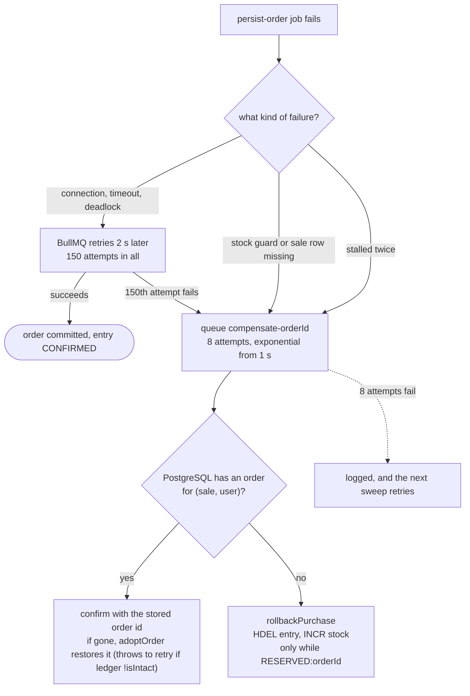
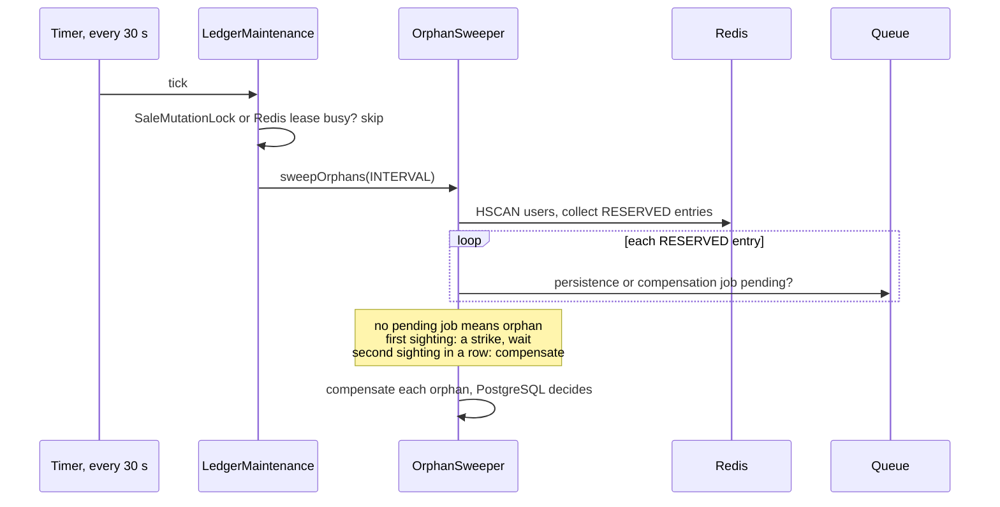
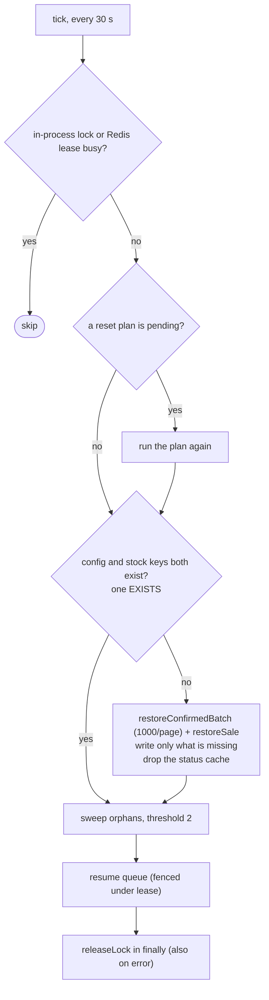

[← README](../README.md)

# Fault tolerance

The brief asks what goes wrong under heavy load and how the system copes. This page lists each fault, the mechanism that handles it, how long recovery takes, and the test that proves it. The purchase path itself is in [purchase-flow.md](purchase-flow.md).

## Principles

1. **Redis is fast, and never trusted alone.** PostgreSQL refuses a duplicate order and an order past stock, whatever Redis believes.
2. **Every 202 ends as an order or as a released unit.** Four mechanisms close the gap between a reservation and its order: job retries, compensation, the sweep, and the restore.
3. **Every repair is idempotent and fenced.** A repair writes only while the entry still holds the order id it was made for. A repeat, a late arrival or two repairs racing each other change nothing the second time.
4. **Fail fast, never queue in memory.** When Redis is away, the API answers 503 at once. It does not hold requests until memory runs out.
5. **Expected refusals are values.** Sold out and duplicate are the common case under load, so they cost no stack trace.

## Fault matrix

Times are the worst case the design allows, and the measured ones are marked.

| Fault | What the buyer sees | Mechanism | Recovery time | Proven by |
| --- | --- | --- | --- | --- |
| PostgreSQL down or slow | Purchases still answer 202. Intact-ledger lookups still answer `200 NONE`/`RESERVED`/`CONFIRMED` from Redis; missing-ledger lookups answer `503 TEMPORARY_FAILURE`. Warm featured-product caches serve `lastKnownProduct` (with a 5 s DB retry backoff; cold cache answers `503`). `/health` answers 503 | The pool times out connects at 2 s and statements at 5 s. `GlobalExceptionFilter` maps `isDatabaseUnavailable` to `503 TEMPORARY_FAILURE`. A failed job retries every 2 s, up to 150 attempts | Orders confirm if PostgreSQL returns within about 5 minutes | `pg-blip` stress scenario (45 s outage), `order-persistence.processor.classification.spec.ts`, `global-exception.filter.spec.ts`, `database-fault.util.spec.ts`, `products.service.spec.ts`, `orders.service.spec.ts` |
| PostgreSQL rejects an order for good (stock guard fails, sale row missing) | The 202 is withdrawn: the lookup shows `NONE` | The repository throws `OrderPersistenceRejectedError`, the processor turns it into BullMQ's `UnrecoverableError`, and compensation starts after one attempt | Seconds | `orders-repository.db.spec.ts`, `order-persistence.processor.classification.spec.ts` |
| PostgreSQL stays down past the retry budget | The 202 is withdrawn after about 5 minutes | The last failed attempt queues a compensation job. When PostgreSQL answers, compensation confirms an order that did commit, or releases the unit | Once PostgreSQL answers | `order-compensation.redis.spec.ts` |
| Compensation exhausts its 8 attempts | Nothing new | An error is logged. The next maintenance sweep treats the entry as an orphan and compensates again | 30 to 60 s | `orphan-sweeper.redis.spec.ts` |
| Redis unreachable | Every route answers 503 `TEMPORARY_FAILURE` at once. A command that is already in flight times out after 2 s (up to about 4 s observed under pipelined load) | The hot-path client has no offline queue and reconnects in 50 ms steps, capped at 2 s. The global filter maps a Redis fault to 503. Queued jobs survive in Redis through AOF | Normal on reconnect | `redis-connection.options.spec.ts`, `redis-fault.util.spec.ts`, `global-exception.filter.spec.ts`, `order-persistence-producer.redis.spec.ts` |
| API dies, or Redis fails, between the gate and the enqueue | 503 for that request. A retry by the same buyer gets 409, and other buyers can get 410 while the unit stays held | The entry is `RESERVED` with no job: an orphan. The sweep compensates it after it sees the same order id on two consecutive ticks | 30 to 60 s | `orphan-sweeper.redis.spec.ts` |
| The enqueue reply is lost, but the job is stored | 202 | `scheduleReservation` looks the job up by its id. A stored job keeps the reservation | Immediate | `order-persistence.lost-reply.redis.spec.ts` |
| The enqueue fails and the job is not stored | 503 | The reservation is released and the unit returns. A job that appears later finds its entry gone and writes nothing | Immediate | `order-persistence-fence.redis.spec.ts` |
| Redis restarts with `appendfsync everysec` | Up to about a second of 202s may vanish: the lookup shows `NONE` | AOF replays everything but the last second. PostgreSQL's unique key and stock guard still refuse a duplicate or an extra order, and compensation releases the loser | Immediate after replay | Design, plus the PostgreSQL guards under test in `schema-constraints.db.spec.ts` |
| Redis loses all data (`FLUSHALL`, lost volume) | Purchases answer 503. Status answers `503 TEMPORARY_FAILURE` while PostgreSQL still holds the campaign (`404 FLASH_SALE_NOT_FOUND` only if absent in both) | Under the Redis maintenance lease (`flash_sale:{saleId}:maintenance_lock`), the tick finds the config or stock key missing, restores confirmed orders in 1,000-row keyset batches (`restoreConfirmedBatch`) plus missing config/stock (`restoreSale`), and fences `queue.resume()`. In-flight jobs whose orders already committed to PostgreSQL adopt cleanly via `adoptCommittedOrStale` (`adoptOrder` adopts even at `stock <= 0` when `stock` exists, clamping displayed `remainingStock >= 0`, and retries while `!isIntact`); reservations and jobs that lived only in Redis are gone, so those 202s never become orders and their units return to stock | Within one 30 s tick | `ledger-maintenance.redis.spec.ts`, `flash-sale-hydration.redis.spec.ts`, `sale-ledger.lease.redis.spec.ts`, `order-persistence.adopt.redis.spec.ts`, `sale-ledger.adopt.redis.spec.ts`, `order-persistence.restore-retry.spec.ts` |
| Stock key lost, config present | Purchases answer 503, and status answers 503 | The gate answers `SALE_NOT_CONFIGURED` and never a false `SOLD_OUT`. Non-`FOUND` status reads are not cached. The tick restores stock as `totalStock - HLEN(users)` | Within one tick | `sale-ledger.reserve.redis.spec.ts`, `sale-ledger.state.redis.spec.ts`, `flash-sales.service.spec.ts` |
| The worker's event loop blocks past the 30 s job lock | Nothing. The 202 stands | BullMQ requeues the job. A job that stalls twice fails and is compensated. Persist is idempotent, so a second run adds nothing | 30 to 60 s | `order-persistence.processor.spec.ts` (a stalled-out job is compensated), `orders-repository.db.spec.ts` (parallel retries of one reservation write one row). The stall itself is not simulated |
| API process crash | Connection errors | `restart: unless-stopped` restarts it. On boot it acquires `flash_sale:{saleId}:maintenance_lock` (up to 50 × 100 ms retries, skipping with a warning if held) to hydrate missing keys, resume the queue under the lease, and sweep per `APP_ROLE` (`all`: threshold 1 `'BOOT'`; `api`: boot sweep skipped; `worker`: threshold 2 `'INTERVAL'`). BullMQ reruns active jobs | About a minute | `ledger-maintenance.bootstrap.spec.ts`, `orphan-sweeper.spec.ts`, `flash-sale-hydration.redis.spec.ts`. Crash and restart were also driven live on Docker (invariant held after 64 s) |
| A reset fails after PostgreSQL committed | The reset call answers an error; because `invalidateState` already deleted Redis keys before SQL committed, status and purchases answer `503 TEMPORARY_FAILURE` (never serving the old sale) | In `APP_ROLE=all`, the next tick finishes the in-memory `pendingPlan` (or heals via `restoreIfLost` after restart). In split `api` + `worker` mode, `worker`'s next tick heals Redis from PostgreSQL via `restoreIfLost` even without `api`'s `pendingPlan` | Up to 30 s | `flash-sale-reset.partial-failure.redis.spec.ts`, `flash-sale-reset.pending.spec.ts` |
| A client resends a Redis command after a lost reply | The same answer | Every script is safe to repeat. `attemptPurchase` answers `RESERVED` again for the same order id and does not decrement twice | Immediate | `flash-sale-scripts.idempotency.redis.spec.ts` |
| SIGTERM during traffic | In-flight requests finish | The timer stops, the worker finishes its jobs, the queues close, and Redis quits last | Immediate | `shutdown-order.redis.spec.ts` |

## Observed on the running stack

Three faults were also driven by hand on the Docker stack with continuous ledger healing, orphan sweeping, and retry recovery active. One run each, so the times depend on where in the 30 s cycle the fault lands.

| Fault | What was done | Observed |
| --- | --- | --- |
| Redis loses all data | `redis-cli FLUSHALL` after one buyer had a confirmed order, on a sale of 5 units | Status and purchases answered 503 `TEMPORARY_FAILURE` (`FlashSalesService` checks PostgreSQL when Redis has no config). After 8 s the status was back with `remainingStock` 4, the buyer's order was still `CONFIRMED`, and a new purchase answered 202 |
| An orphaned reservation | Wrote `RESERVED:<id>` for a ghost buyer straight into Redis and decremented stock, with no job queued | The lookup showed `RESERVED`. After 45 s the entry was gone, stock was back from 4 to 5, the lookup showed `NONE`, and the log held one warning with `RELEASED: 1` |
| PostgreSQL down for 45 s | The `pg-blip` scenario in `pnpm stress:node` | 3 × 202 and 97 × 410, and all three reservations `CONFIRMED` within 90 s. The whole suite printed 53 `PASS` lines and `STRESS OK` |

## Retry, compensation and adoption



Compensation asks PostgreSQL first. A blind release would be wrong for an attempt that committed but lost its Redis write, because it would give the unit away a second time. Compensation is also idempotent: the rollback only fires while the entry still equals `RESERVED:<orderId>`, so a repeat or a late rollback changes nothing.

Retrying for about five minutes is a chosen budget. A short outage costs nobody anything, because the buyers already have their 202, and PostgreSQL returns before the budget ends. A longer outage withdraws the 202 and returns the unit, which is better than holding a unit for an order that cannot be written.

## The sweep: orphans

An orphan is a `RESERVED` entry with no persistence or compensation job in a state that can still run (`waiting`, `delayed`, `active`, `prioritized`, `waiting-children`). It appears when the process dies, or Redis fails, between the gate and the enqueue.



During traffic an entry is also jobless for a moment, between the Lua step and `queue.add`. So an interval sweep waits for a second sighting of the same order id before it acts. At boot under `APP_ROLE=all`, no request has started yet, so the threshold is 1 (`BOOT`); in split mode, `APP_ROLE=api` skips boot sweeping (`null`) and `APP_ROLE=worker` uses threshold 2 (`INTERVAL`) at boot because live `api` replicas may have enqueues in flight. Strikes are keyed by order id, so a new reservation by the same buyer starts clean. Hence 30 s to 60 s: an orphan is first seen at one tick and acted on at the next.

The decision itself is a pure function, `decideSweep`, with its own tests.

## The tick: self-healing



All writers of sale-wide state (boot heal, scheduled ticks, and admin reset) serialize through `SaleMutationLock` inside the process and through the distributed Redis lease `flash_sale:{saleId}:maintenance_lock` (`SET ... PX 25000 NX`, released via `releaseLock` Lua script in `finally`): ticks skip on 1 attempt if busy, boot retries up to `50 × 100 ms` (warning and skipping if still held), and reset retries up to `20 × 100 ms` (`503 TEMPORARY_FAILURE` if still held). Queue resumption (`resets.resumeProcessing()`) also runs inside this lease during boot and maintenance ticks rather than unguarded on bootstrap, preventing a restarting replica from unpausing an in-progress reset. The check while the ledger is intact is one `EXISTS` and no PostgreSQL read. The tick never seeds or reschedules, so a key lost mid-run cannot undo an admin reset by reapplying the boot rule. `restoreSale` never deletes an entry, so a live reservation survives a partial loss.

## Reset, and why it can recover

Reset is a demo tool, but it is also the only write that spans both stores, so it is built to survive a failure in the middle across both single-process and split `api` + `worker` deployments.

```mermaid
sequenceDiagram
    participant C as Caller
    participant S as ResetService
    participant Q as Queue
    participant P as PostgreSQL
    participant R as Redis

    C->>S: POST /admin/flash-sales/reset
    S->>S: acquire SaleMutationLock
    S->>R: acquire maintenance_lock (up to 20 x 100 ms; 503 if busy)
    S->>Q: pause, wait for active jobs (10 s at most), drain
    S->>R: invalidateState (DEL config, stock, users)
    S->>P: one statement: delete the sale's orders and rewrite the sale row
    S->>S: remember pendingPlan
    S->>R: replace config, stock and users in one MULTI
    S->>S: forget pendingPlan, drop the 200 ms status cache
    S->>Q: resume (finally)
    S->>R: releaseLock (finally)
    S-->>C: read & return the new sale status
```

- The orders delete and the sale update are one SQL statement, so one transaction. A failure before SQL commits leaves the old PostgreSQL row whole (and the next tick restores Redis if needed).
- `invalidateState` deletes the Redis keys **before** PostgreSQL commits, and `pendingPlan` is remembered before `replaceState`. If `replaceState` fails (or the `api` process dies after SQL commits, including in split `api` + `worker` mode where `api` has no ticks), Redis never serves the old sale and the next maintenance tick heals Redis from the committed PostgreSQL row via `pendingPlan` or `restoreIfLost`.
- If `maintenance_lock` stays held for 2 s or jobs in flight do not finish within 10 s, the reset answers `503 TEMPORARY_FAILURE` (releasing the lock and resuming the queue in `finally`).
- Once `invalidateState` runs, new purchases answer `503 SALE_NOT_CONFIGURED` until `replaceState` completes; only a purchase whose Lua script ran before `invalidateState` gets `202` and settles as `STALE` with no order. This is why reset is not linearizable with purchases, and why it is a demo tool.

## What is not covered

These are the known gaps, stated plainly, with the reason each was accepted. [scaling.md](scaling.md) covers the single-instance limits.

- **Losing only the `users` hash** while config and stock remain is not noticed. Both the maintenance tick and `OrdersService.getUserOrderStatus` (`readSlotWithLedgerState`) check only `:config` and `:stock`, so losing `:users` alone leaves the ledger "intact" and causes non-present lookups to return `NONE` without querying PostgreSQL.
- **Compensation can race a live persist** only if the event loop blocks longer than the 30 s job lock.
- **A lost enqueue reply plus a failed job lookup** can answer 503 for a buyer whose order then commits. A retry answers 409, and the lookup shows the order.
- **Up to about a second of 202s** can vanish on a Redis crash. The alternative, `appendfsync always`, would cost throughput on the hot path.
- **No Redis replica.** A Redis primary that is gone for good takes the live state with it. PostgreSQL still holds every order, and the restore rebuilds the ledger from it.
