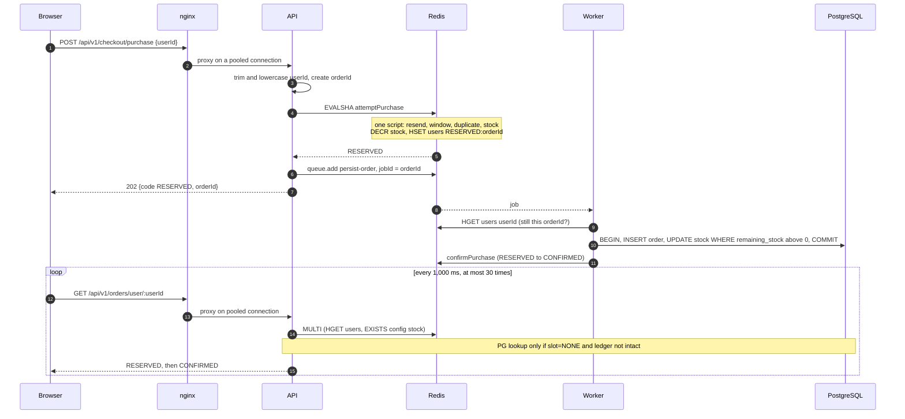
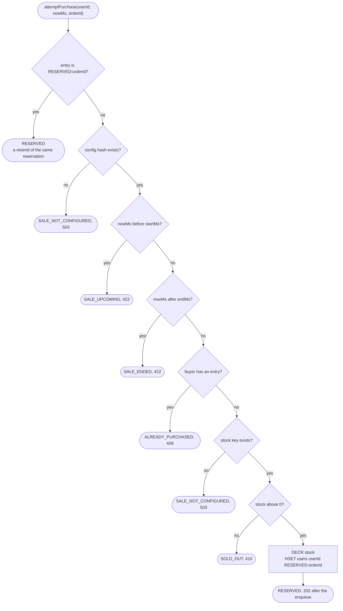
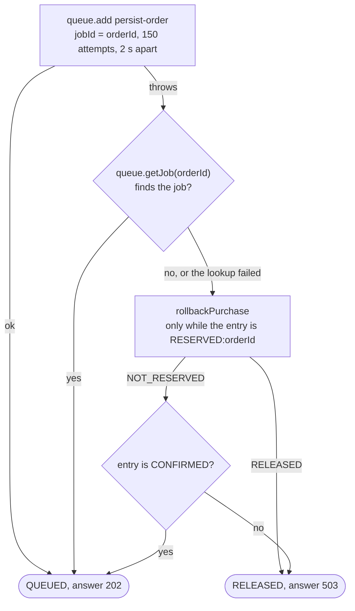
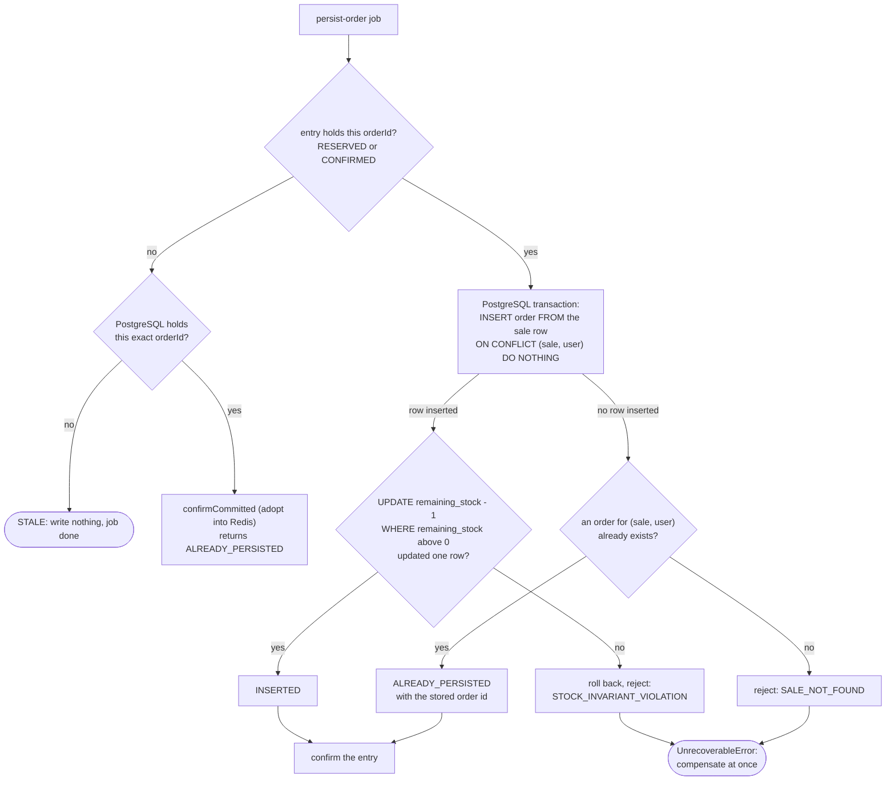
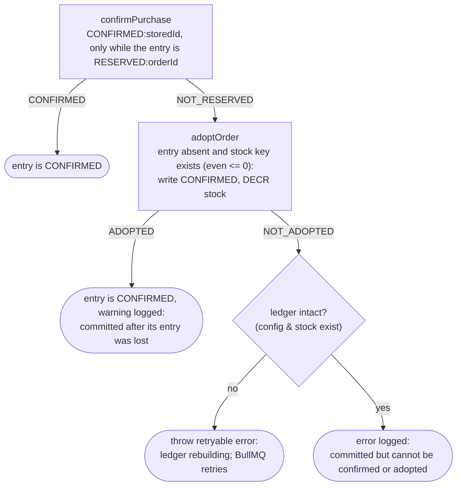
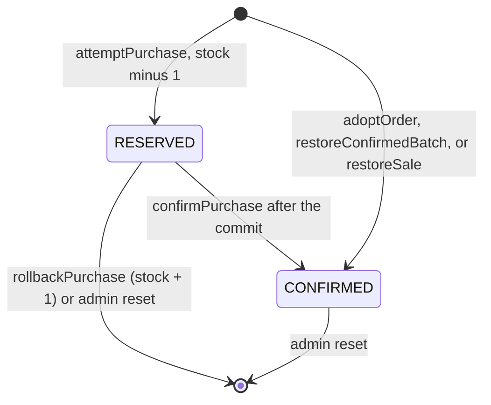
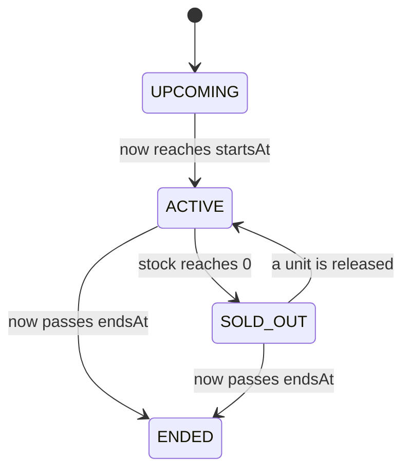
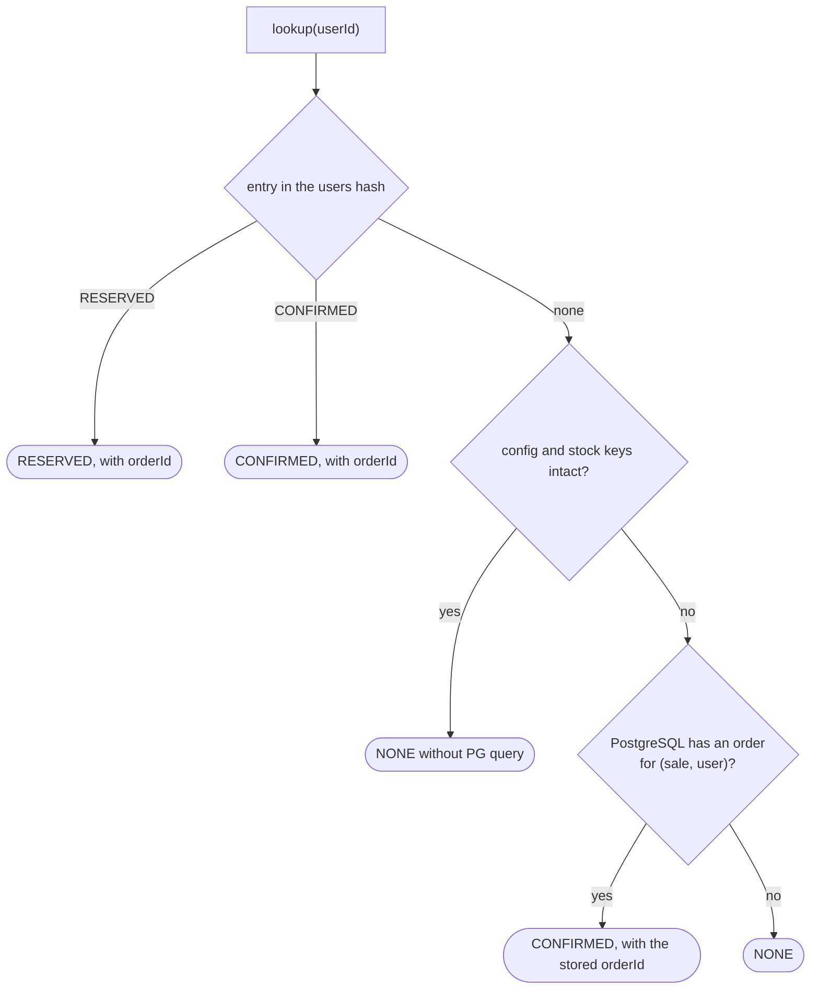
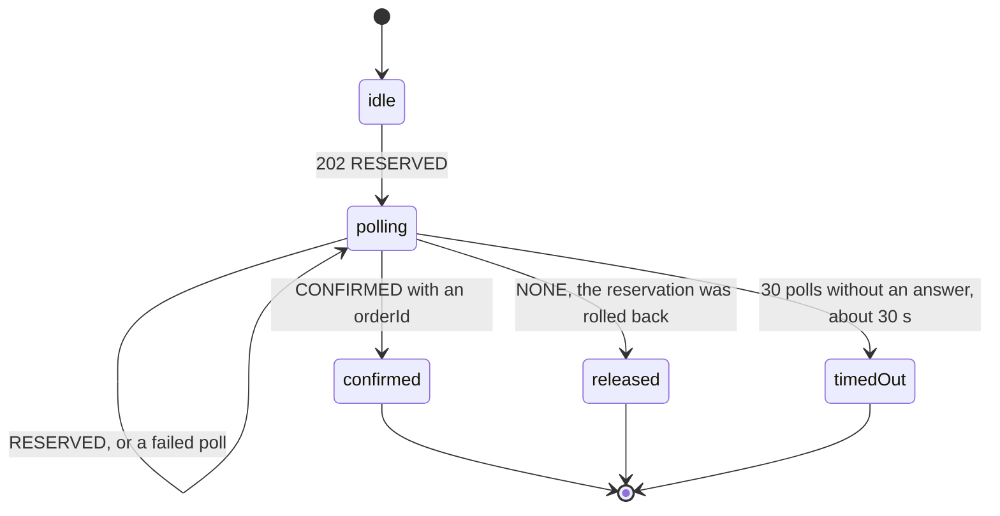

[← README](../README.md)

# Purchase flow

This page follows one purchase from the click to the PostgreSQL row, one stage at a time. Each stage has its own diagram. Failures of each stage are in [fault-tolerance.md](fault-tolerance.md).

## The whole path

The request ends at step 7. The buyer waits for Redis twice (the script, the enqueue) and never for PostgreSQL. Steps 8 to 11 happen after the answer, which is why the HTTP status is 202 Accepted and not 201 Created: the reservation is accepted, and the order is not yet written.

## Stage 1: the user id

The controller binds `userId` through one pipe. The pipe trims and lowercases the value, then checks that it is 3 to 128 characters of `a-z`, `0-9`, `.`, `_`, `@`, `+` or `-`. A bad value answers 400 `INVALID_USER_ID`. A good value becomes a `NormalizedUserId`, a branded string type, and a raw `string` cannot reach a service or repository without a compile error.

So `" Alice@Example.com "` and `alice@example.com` are one buyer. Without this step, a buyer could take a second unit by changing the case of an email. The `same-user-race` stress scenario sends 300 requests in four spellings of one id and expects exactly one 202, and the end-to-end suite does the same with 50 requests.

## Stage 2: the gate

`attemptPurchase` is one Lua script. Redis runs scripts one at a time, so everything below happens with no other command in between.

The order of the checks is part of the contract, and each step has a spec.

- **The resend check is first.** If a Redis client resends the command after a lost reply, it carries the same `orderId`, and the answer is `RESERVED` again with no second `DECR`. This holds even after the sale ended.
- **The window is inclusive at both ends.** A request at `startMs` or `endMs` is accepted. The API passes its own clock time in as `nowMs`. An integration spec runs the real script at `startsAt - 1`, `startsAt`, `endsAt` and `endsAt + 1`, and expects `SALE_UPCOMING`, `RESERVED`, `RESERVED` and `SALE_ENDED`.
- **A sold-out sale reports `SALE_ENDED` once it is over**, and a buyer who holds a unit gets `ALREADY_PURCHASED` before `SOLD_OUT`. Both orders are tested.
- **A missing key is not zero.** A missing config hash or stock key means Redis lost state. It answers `SALE_NOT_CONFIGURED`, which the API turns into 503, and never a false `SOLD_OUT`.

Expected refusals are returned as values, not thrown. At sold-out load most requests are refusals, and a thrown exception captures a V8 stack trace for each one. `CheckoutService.attemptPurchase` returns a discriminated union, and the controller maps it through a table typed `Record<PurchaseOutcome, HttpStatus>`. Adding an outcome without a status fails the build.

## Stage 3: the enqueue

After `RESERVED`, the API adds one job. The job id is the order id. BullMQ refuses custom ids that contain `:`, so `saleId:userId` cannot work, and the order id is unique per reservation, so the same buyer can buy again after a reset without hitting an old job.

If `queue.add` throws, the answer may still be unknown: the job may be stored and only the reply lost.

The reservation is kept only when the job is known to exist or the order is already confirmed (a finished job is removed from the queue, so its confirmed entry is the proof). In every other case the unit goes back and the buyer sees 503 `TEMPORARY_FAILURE`. A job that was stored after all finds its entry gone and writes nothing.

## Stage 4: the worker

The worker takes jobs with concurrency 20. For each job it runs `persistReservedOrder`.

| Outcome | Meaning | What the worker does next |
| --- | --- | --- |
| `STALE` | The reservation was released or reset before the job ran, and PostgreSQL does not hold `orderId` | Nothing. The job completes |
| `INSERTED` | The order is new and stock was decremented in the same transaction | Confirms the entry |
| `ALREADY_PERSISTED` | An order for this buyer already exists in PostgreSQL (including when `!isReservationLive` after a Redis flush matches `orderId`) | Confirms or adopts the entry with the stored order id |
| A rejection | The two cases that can never succeed: the stock guard failed, or the sale row is missing | Fails the job at once as unrecoverable, and compensation takes over |
| Any other error (connection refused, statement timeout, deadlock) | A fault that may pass | Throws, and BullMQ retries 2 s later, up to 150 attempts |

The insert takes `product_id` from the sale row, so the job carries only the reservation identity. The stock decrement runs only for a fresh insert, which is why a retried job cannot decrement twice.

### Confirming the entry

`confirmPurchase` is a compare-and-set: it writes only over the exact `RESERVED:<orderId>` the job was created for. So a reservation that was released can never come back as `CONFIRMED`. If the order committed but its Redis entry vanished (for example during a Redis flush or chunked restore), `adoptOrder` puts the entry back and takes the unit; if `adoptOrder` sees missing ledger keys while `restoreIfLost` is mid-rebuild, `confirmCommitted` throws a retryable error so BullMQ retries adoption once the ledger is intact.

## The life of a buyer's entry

A reservation is released when the enqueue fails and the job does not exist, when compensation finds no order in PostgreSQL, when the sweep finds a reservation with no job, or when an admin reset wipes the sale.

## Reading the result

### Sale status

`GET /api/v1/flash-sales/current` reads the config hash and the stock key in one `MULTI` and computes the state from the server clock.

The checks run in the order `UPCOMING`, `ENDED`, `SOLD_OUT`, `ACTIVE`. Only `FOUND` Redis `SnapshotRead` promises (with `remainingStock` clamped `>= 0`) are micro-cached for 200 ms with singleflight coalescing, while `serverTime` and `saleState` are computed fresh per request from `ClockService` (so window transitions flip immediately). Non-`FOUND` reads are never cached: when Redis holds no config (`NOT_CONFIGURED`), `FlashSalesService` checks PostgreSQL and answers `503 TEMPORARY_FAILURE` if PostgreSQL holds a campaign (or is unavailable), returning `404 FLASH_SALE_NOT_FOUND` only when neither store has one; missing stock with config present answers `503 TEMPORARY_FAILURE`.

### Order lookup

`GET /api/v1/orders/user/:userId` emits `Cache-Control: no-store` and reads the user's slot and whether the ledger keys (`:config` and `:stock`) exist in one Redis `MULTI` (`readSlotWithLedgerState`). While the ledger is intact, a missing slot returns `NONE` directly from Redis without hitting PostgreSQL (cache-penetration guard); only when ledger keys are missing does lookup fall back to PostgreSQL.

`NONE` after a 202 means the reservation was released. The storefront shows that as "Reservation released". When `RATE_LIMIT_ENABLED=true`, both `POST /checkout/purchase` and `GET /orders/user/:userId` enforce the per-IP `RateLimitGuard` (`429 RATE_LIMITED`), keying by `request.ip` governed by `TRUST_PROXY` (`false` default; `true` in Compose behind nginx's `X-Forwarded-For $remote_addr`).

## In the browser

`UserIdField` validates format inline (`3–128 characters: a–z, 0–9, . _ @ + -`), and "Buy Now" is locked while the sale is not `ACTIVE` on the server-corrected clock (via `useEffectiveSaleState`'s boundary-scheduled `setTimeout`), while a request is in flight, and while the user id is blank. After a 202 (and again on confirmation or release), the checkout card triggers an immediate sale status refresh and starts a fresh `[userId, orderId]`-keyed polling session (`useOrderConfirmationPoller`, 1,000 ms × 30 attempts).

| Answer | Banner title | Tone |
| --- | --- | --- |
| 202 `RESERVED` | Reserved! Confirming your order... | info |
| then `CONFIRMED` | Order confirmed | success |
| then `NONE` | Reservation released | warning |
| after 30 polls | Still confirming | info |
| 409 `ALREADY_PURCHASED` | Already purchased | warning |
| 410 `SOLD_OUT` | Sold out | danger |
| 422 `SALE_UPCOMING` | Sale has not started | info |
| 422 `SALE_ENDED` | Sale has ended | neutral |
| 400 `INVALID_USER_ID` | Invalid user ID | warning |
| 429 `RATE_LIMITED` | Too many requests. Please wait a moment and try again. | warning |
| 503 `TEMPORARY_FAILURE` | Temporarily unavailable | danger |

The table is typed `satisfies Record<FeedbackCode, ...>` over the web module's `FeedbackCode` union so every known frontend code has a banner; any unlisted backend code falls back to `FALLBACK_PURCHASE_FEEDBACK` (`"Purchase failed"`).
