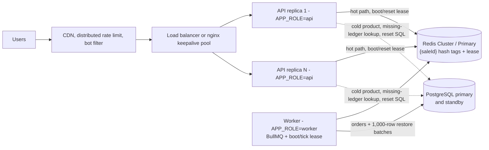

[← README](../README.md)

# Scaling and limits

The brief asks for a design that can grow, and for the bottlenecks to be named. This page separates three things: what was **measured**, what is **already built** for horizontal split scaling (`APP_ROLE`, `docker-compose.scaled.yml`, Redis cluster hash tags, distributed maintenance lease across boot/ticks/resets, chunked hydration, micro-caches, `/metrics`, optional `RateLimitGuard` with `TRUST_PROXY` + nginx `X-Forwarded-For $remote_addr`, and `ADMIN_API_KEY`), and what **would change next** for 10x–100x production load.

## What limits throughput today

Measured on one 4-vCPU WSL2 machine that the load generator, the API, Redis and PostgreSQL all shared ([benchmarks.md](benchmarks.md)). The absolute numbers move by 15 to 30% from run to run, so read the ratios.

| Part | Load at the measured peak | What it says |
| --- | --- | --- |
| API main thread | 4,486 req/s at 222 µs of CPU per request, which is 1.00 core | The Node main thread is the ceiling, and it is saturated |
| Redis | 0.10 core | Far from its limit. Redis CPU per request is 28 µs |
| PostgreSQL | 0.05 to 0.09 core | Barely used, because only the 100 winners write |
| Queue | 100 orders confirmed 1.5 s after the last 202 | The worker keeps up with the burst |

So the first thing to scale is the number of API processes. Redis and PostgreSQL have room for it.

## Bottlenecks and what each would need

| Bottleneck | Limit | Mitigation | Built? |
| --- | --- | --- | --- |
| One API process | About 4,486 req/s per core (measured) | Run `APP_ROLE=api` stateless HTTP replicas behind a load balancer (`docker-compose.scaled.yml` removes host port binding on `api` so `--scale api=N` works). Featured product (60 s) and sale status (200 ms) micro-caches bound Redis/DB reads per replica | **Yes** (`APP_ROLE=api` + `docker-compose.scaled.yml`) |
| Event-loop sharing | Under `APP_ROLE=all`, the worker shares the request thread, adding to the p99 tail during the order burst | Run the worker and 30 s maintenance loop in a dedicated `APP_ROLE=worker` container (`APP_ROLE=api` still hydrates on boot under the Redis lease while disabling ticks and boot sweeps; `worker` keeps `/health` and `/metrics` and uses 2-strike `'INTERVAL'` sweeping at boot) | **Yes** (`APP_ROLE=worker` + `docker-compose.scaled.yml`) |
| Redis primary | One Redis core. The gate is a constant-time script, and 0.10 core served 4,486 req/s, so there is room well past that (extrapolated, not measured) | `{saleId}` cluster hash tags (`flash_sale:{saleId}:*`) colocate one sale's keys on one Redis Cluster slot so multiple sales shard horizontally. Splitting a single huge sale's stock into sub-buckets (`flash_sale:{saleId:shard}:stock`) is not built | Hash tags: **Yes**. Stock sub-buckets: **No** |
| PostgreSQL writes | Each confirmed order runs `UPDATE flash_sales SET remaining_stock = remaining_stock - 1 ...`, taking a row lock on the single sale row | The BullMQ queue and 20-connection pool absorb bursts today. For 10x–100x write throughput, micro-batch order inserts and deduct `remaining_stock` once per batch instead of once per order | Queue + pool: **Yes**. Micro-batch stock decrement: **No** |
| Sweep and restore cost | A full restore used to read all orders in one query; the sweep walks every entry of `users` via `HSCAN` each 30 s | Restore now uses keyset-paginated 1,000-row batches (`idx_orders_sale_status_created` + `restoreConfirmedBatch`). A secondary Redis index for `RESERVED` entries is not built | Chunked hydration: **Yes**. Reserved index: **No** |
| Read storms & non-buyer lookups | Unknown-user polling could hit PostgreSQL; product reads could stampede on miss | `OrdersService` returns `NONE` from Redis when ledger keys are intact; `ProductsService` uses a 60 s singleflight cache (+ stale fallback and `Cache-Control`). CDN/edge caching for `/products/featured` and `/flash-sales/current` sits outside the app | App caches/guard: **Yes**. Edge CDN: external |
| Connection setup | Node accepts one pending connection per event-loop iteration | nginx keeps a 256-connection pool (`keepalive_requests 10000`) to the API; k6 scripts warm connections via `GET /health` | **Yes** |

## Split topology and what remains for multi-worker / 10x–100x load

`docker-compose.scaled.yml` runs stateless `APP_ROLE=api` HTTP replicas alongside a dedicated `APP_ROLE=worker` container (`docker compose -f docker-compose.yml -f docker-compose.scaled.yml up -d --scale api=3`). Boot hydration (`LedgerMaintenanceService`), scheduled maintenance ticks, and admin resets (`FlashSaleResetService`) all coordinate across processes using the Redis lease `flash_sale:{saleId}:maintenance_lock` (25 s TTL, atomic `releaseLock`).

What is built versus what changes if scaling beyond one worker or across regions:

| State / Mechanism | Current status | Why it matters when scaling further | Next step |
| --- | --- | --- | --- |
| Cross-process lease (`flash_sale:{saleId}:maintenance_lock`) | **Built** (boot, 30 s ticks, and admin reset) | Serializes boot hydration, maintenance ticks, and admin resets across containers; in-process `SaleMutationLock` remains local | Already Redis-leased |
| Partial reset recovery & `OrphanSweeper.strikes` | **Split-safe reset built; strikes in-process** | `FlashSaleResetService` deletes Redis keys (`invalidateState`) before SQL commits, so `worker` heals failed `api` resets via `restoreIfLost` even without `api`'s in-memory `pendingPlan`. `OrphanSweeper.strikes` is still per worker process (fine with one `worker`; two workers count strikes separately) | Move orphan strikes to Redis if running multiple workers |
| Per-replica micro-caches (`ProductsService` 60 s, `FlashSalesService` 200 ms) | **Per-process memory** | Reset or heal invalidates only the executing process's status cache; sibling `api` replicas expire within 200 ms | Short TTL (200 ms) already bounds staleness; add pub/sub invalidation only if tighter SLA is needed |
| Prometheus counters (`MetricsService`) | **Per-process memory** | Each `api` replica holds its own purchase counters and `worker` holds persistence counters on internal port `3000` | Scrape every `api` replica and `worker` separately and aggregate via PromQL `sum(...)` |
| Sale window clock (`ClockService`) | **Per-process clock** | Skewed clocks across `api` replicas could disagree at exact `startsAt` / `endsAt` boundaries | Read `redis.call('TIME')` inside `attemptPurchase` |
| Rate limiting (`RateLimitGuard`) | **Built, in-memory** (`RATE_LIMIT_ENABLED`, `TRUST_PROXY`) | Each `api` replica keeps up to 50,000 per-IP buckets independently (keyed by `request.ip`, with nginx setting `X-Forwarded-For $remote_addr` when `TRUST_PROXY=true`) | Move rate limiting to edge WAF/API gateway or Redis counters |
| PostgreSQL pool of 20 per process | **Per-process pool** | `N` `api` replicas + worker each open up to 20 connections (though `api` replicas rarely touch PostgreSQL while ledger is intact) | Size against `max_connections` / PgBouncer, and keep `api` pool smaller than `worker` |
| Stock hot row (`flash_sales.remaining_stock`) | **One `UPDATE` per order** | Serializes row locks on the single sale row at high sustained confirmation rates | Micro-batch stock decrement in the worker |
| Single Redis shard per sale | **`{saleId}` hash tags built** | One sale's Lua script runs on one Redis primary shard | Shard stock into sub-buckets (`{saleId:0}`..`{saleId:K-1}`) for mega-sales |

## Availability

| Gap | Option | Trade-off |
| --- | --- | --- |
| Redis loses up to about a second on a crash | `appendfsync always` | Every write waits for the disk, which costs hot-path throughput |
| A lost Redis primary takes the live state | A replica with Sentinel, and `min-replicas-to-write` | Asynchronous replication can also lose the last writes at a failover, so the PostgreSQL guards stay necessary. The restore rebuilds the ledger from PostgreSQL in 1,000-row batches |
| One PostgreSQL | A standby | The workers already retry for 5 minutes, which covers a failover |

## Production checklist

- **Prometheus scraping and alerts.** `GET /metrics` exports `flash_sale_purchase_attempts_total`, `flash_sale_order_persistence_total`, and `flash_sale_order_queue_jobs` on internal port `3000` (not proxied by nginx; unpublished on the host in `docker-compose.scaled.yml`). Scrape every `api` replica and `worker` separately inside the internal network and alert on queue depth, failed jobs, 503 rate, p99 latency, Redis memory, and `/health` failures.
- **Distributed rate limiting and bot filtering.** Built-in `RATE_LIMIT_ENABLED=true` (paired with `TRUST_PROXY=true` behind a proxy that overwrites `X-Forwarded-For` with `$remote_addr`, as `nginx.conf` does) covers single-node per-IP throttling; put edge rate limiting and authenticated user identity in front of `/checkout/purchase` when running multiple replicas.
- **Protect the reset endpoint.** Leave `ENABLE_ADMIN_ENDPOINTS=false` in production, or set a strong `ADMIN_API_KEY` (`x-admin-key`) and restrict network access.
- **A cheaper sold-out path & waiting room.** After stock hits zero, short-circuiting 410s at the edge or API without calling Redis (at the cost of brief staleness on unit release) and queueing opening-second traffic in a waiting room protects origin capacity at 100x spikes.
